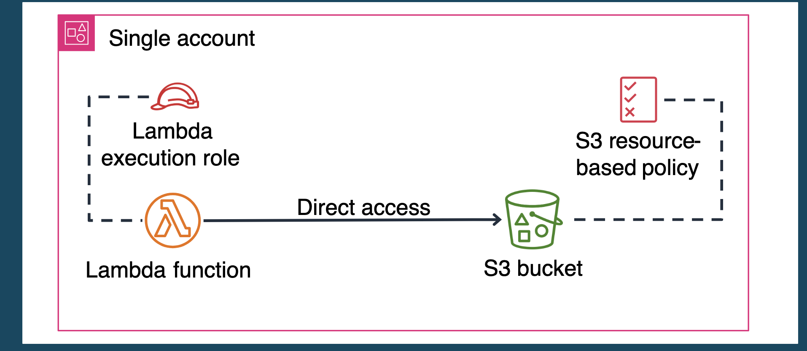
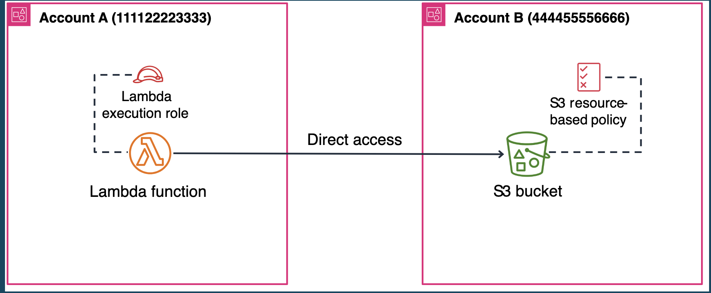
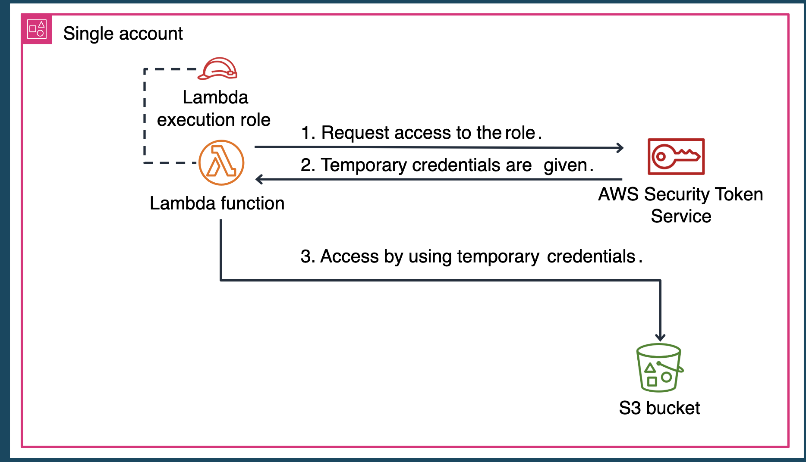
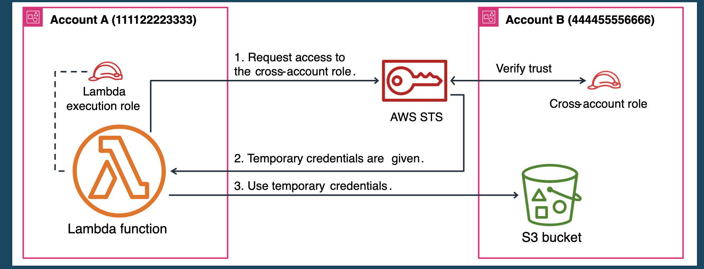

# Managing Access to AWS Resources (IAM)

## IAM Overview

IAM (Identity and Access Management) là web service giúp bạn quản lý quyền truy cập vào tài nguyên AWS. IAM đảm bảo chỉ những user và application được ủy quyền mới có thể tương tác với service và resource của bạn.

IAM kiểm soát **ai được truy cập cái gì** dựa trên hai câu hỏi:

- **Authentication** — ai đã đăng nhập (đã xác thực danh tính).
- **Authorization** — ai có quyền (permissions) để dùng tài nguyên.

Ngoài ra, IAM còn giúp đáp ứng yêu cầu compliance nhờ khả năng kiểm soát chi tiết quyền truy cập tài nguyên.

## IAM is Globally Scoped

> "IAM is globally scoped rather than AWS Region specific."

Hầu hết dịch vụ AWS là **regional** — bạn tạo EC2 ở `ap-southeast-1` thì nó chỉ tồn tại ở đó, sang `us-east-1` sẽ không thấy. IAM thì ngược lại: user, group, role, policy bạn tạo ra **không thuộc region nào cả** — chúng tồn tại ở cấp account và hiện diện đồng thời ở mọi region.

Nói cách khác: một IAM user tạo một lần là dùng được ở tất cả region trong account đó, không phải tạo lại ở từng region.

### Ba lợi ích của IAM global

| # | Lợi ích | Ý nghĩa |
|---|---------|---------|
| 1 | **Consistent access control across all Regions** (Kiểm soát truy cập nhất quán mọi region) | Vì identity/policy là global, quyền của một user/role giống hệt nhau ở mọi region. Không thể có tình huống "user này đọc được S3 ở Singapore nhưng thiếu quyền ở Tokyo" do cấu hình lệch region. Một policy = một hành vi phân quyền, áp dụng đồng đều toàn cầu. |
| 2 | **Automatic replication of policies across Regions** (Tự động đồng bộ policy khắp region) | Sửa một policy (thêm/siết quyền) → thay đổi có hiệu lực ở tất cả region ngay lập tức, không phải copy-paste sang từng region. Không có chuyện "quên cập nhật region kia". Đây là hệ quả trực tiếp của việc IAM chỉ có một bản duy nhất ở cấp account. |
| 3 | **Centralized management for multi-Region deployments** (Quản lý tập trung cho triển khai đa region) | Khi app chạy trên nhiều region, bạn vẫn quản lý identity/permission ở một chỗ duy nhất. Một role cho Lambda ở 3 region → định nghĩa một lần, cả 3 region dùng chung. Giảm công sức vận hành và rủi ro sai sót do quản lý phân tán. |

### Những bẫy cần tránh (IAM global ≠ mọi thứ đều global)

- **STS có endpoint theo region.** User/role/policy là global; nhưng khi lấy temporary credentials qua STS, endpoint `sts.<region>.amazonaws.com` là **regional** (dù credentials dùng được toàn cầu). Đừng nhầm "IAM global" = mọi thứ liên quan auth đều global.
- **IAM Identity Center (SSO) là regional**, khác với IAM cổ điển. Bạn phải chọn một region để bật Identity Center. Đây là bẫy hay gặp.
- **S3 bucket** là global namespace về **tên**, nhưng dữ liệu vẫn nằm ở region cụ thể — khác với "IAM global". Đừng gộp hai khái niệm.

## Federated Users

**Federated user** = người dùng đăng nhập AWS bằng danh tính có sẵn từ hệ thống bên ngoài, thay vì tạo một IAM user riêng trong AWS. AWS tin tưởng nhà cung cấp danh tính (IdP) đó và cấp cho họ **temporary credentials** (qua STS) để truy cập tài nguyên — không lưu username/password trong IAM.

### Ý tưởng cốt lõi

Thay vì mỗi nhân viên có 2 tài khoản (một của công ty, một IAM riêng trong AWS), họ dùng luôn tài khoản công ty để vào AWS. AWS "liên kết" (federate) niềm tin với IdP:

1. IdP xác thực người dùng.
2. IdP nói với AWS "người này hợp lệ".
3. AWS cấp quyền tạm thời.

**Điểm mấu chốt:** federated user **assume một IAM role**, không có identity cố định trong IAM. Credentials tự hết hạn.

> **Best practice:** ưu tiên federation + IAM roles thay vì tạo IAM user với long-term access key.

## IAM Policies

IAM policies được viết ở định dạng **JSON**, dùng để định nghĩa và kiểm soát những action mà một user, group, hoặc role được phép thực hiện trên các AWS resource cụ thể.

### Evaluation logic (thứ tự đánh giá request)

Khi có request truy cập tài nguyên AWS, AWS dùng logic sau để quyết định allow hay deny:

1. **Explicit Deny** — bất kỳ request nào bị từ chối tường minh → **DENY** (ưu tiên cao nhất).
2. **Explicit Allow** — request được cho phép tường minh → **ALLOW**.
3. **Default Deny** — mọi thứ còn lại → **DENY** (mặc định từ chối).

> Quy tắc ghi nhớ: **Explicit Deny > Explicit Allow > Default Deny**.

## Policy Types

Policy là một entity trong AWS; khi gắn vào một identity hoặc resource, nó định nghĩa permissions cho đối tượng đó. AWS đánh giá các policy này mỗi khi một **principal** (user, role, ...) gửi request.

| Policy Type | Gắn vào đâu | Mô tả |
|-------------|-------------|-------|
| **Identity-based policies** | IAM identities (user, group, role) | Managed và inline policies gắn vào identity. Viết bằng JSON. |
| **Resource-based policies** | Trực tiếp lên resource | Inline policy gắn vào resource. Phổ biến nhất: S3 bucket policy và IAM role trust policy. |
| **Organizational SCPs** | Account / OU trong AWS Organizations | Định nghĩa **permissions tối đa** cho các account thành viên. SCP là trần quyền, không tự cấp quyền. |
| **ACLs** | Trực tiếp lên resource | Kiểm soát principal ở account khác được truy cập resource. Giống resource-based policy nhưng **không viết bằng JSON** — format tùy service (XML cho S3, rule table cho network ACL), lưu kèm chính resource đó. |

## IAM Roles for Temporary Access

**IAM role** = một tập permissions xác định entity được làm gì trong AWS. Role dùng để cấp **quyền truy cập tạm thời**, không cần permanent credentials. Tạo qua Console, SDK hoặc CLI.

Khi định nghĩa một role, admin cần hai thành phần:

- **Trust policy** — xác định **ai được phép assume role** (AWS service, application, hoặc user).
- **Permission policy** (một hoặc nhiều) — xác định **role được làm gì** trên resource nào. Có thể là AWS managed, customer managed, hoặc inline policy.

### Luồng assume role

1. Admin tạo trust relationship (trust policy) cho role.
2. IAM user hoặc application từ trusted account gọi **STS `AssumeRole`** API.
3. STS trả về **temporary security credentials**.
4. Dùng credentials tạm đó để truy cập resource, credentials tự hết hạn.

## Common Access Patterns Using Roles

IAM roles hỗ trợ nhiều access pattern, phân loại theo scope, mục đích và trust relationship. Hiểu các pattern này giúp thiết kế security boundary và luồng xác thực phù hợp.

| Pattern | Dùng khi nào |
|---------|--------------|
| **Temporary elevated access** | Nâng quyền tạm thời cho một tác vụ cụ thể, hết việc là hết quyền. |
| **Service-to-service access** | Một AWS service assume role để gọi service khác (vd: Lambda truy cập DynamoDB). |
| **Cross-account access** | Principal ở account này assume role ở account khác. |
| **Federated user access** | User từ IdP bên ngoài assume role (SSO, SAML, OIDC). |
| **Programmatic access** | Application/script lấy temporary credentials qua STS để gọi AWS API. |

## Implementing Access Patterns

Phần này tập trung hai pattern: **service-to-service trong cùng account** và **cross-account access**.

### Same-Account Service-to-Service Communication

Khi các service giao tiếp trong **một account duy nhất**, IAM có hai cách tiếp cận chính:

| Cách | Cơ chế | Lưu ý quan trọng |
|------|--------|------------------|
| **Resource-based policy** | Gắn permissions trực tiếp lên resource, cho các service có hỗ trợ (S3, SNS, Lambda, ...). | **Bắt buộc** khai báo `Principal` — chỉ rõ **ai** được truy cập resource. |
| **Service role** | Tạo IAM role với quyền phù hợp để một AWS service **assume** và thao tác lên service khác. | Quyền đi theo role, không gắn vào resource. |

**Chọn cách nào** phụ thuộc yêu cầu về security, tính linh hoạt, và các service liên quan:

- Dùng **resource-based policy** khi muốn kiểm soát ngay tại resource và service đó có hỗ trợ (vd: policy trên S3 bucket).
- Dùng **service role** khi một service cần đóng vai (assume) để gọi service khác (vd: Lambda assume role để ghi vào DynamoDB).

#### Same-account — Cách 1: Resource-based policy

1. Gắn resource policy **trực tiếp** lên resource (vd: S3 bucket policy).
2. Khai báo các **principal** (gồm cả IAM role mà service dùng) được phép truy cập.

> **Lưu ý:** Các service như Lambda **luôn cần service-specific role** để hoạt động. Trong cùng account, resource-based policy có thể cấp quyền truy cập bucket cho role đó.



Trong một account (**Single account**): Lambda function **Direct access** thẳng tới S3 bucket; bucket mang S3 resource-based policy khai `Principal` là Lambda execution role. Không qua STS, không đổi danh tính.

**Ví dụ:** bucket policy dưới đây cấp cho Lambda execution role quyền `s3:GetObject`. Quyền được định nghĩa **ở cấp resource** → không cần thêm permission S3 nào trên chính Lambda execution role.

```json
{
  "Version": "2012-10-17",
  "Statement": [{
    "Effect": "Allow",
    "Principal": {
      "AWS": "arn:aws:iam::123456789012:role/lambda-execution-role"
    },
    "Action": "s3:GetObject",
    "Resource": "arn:aws:s3:::my-bucket/*"
  }]
}
```

Trong policy:

- `"Principal".AWS` = ARN của Lambda execution role → **ai** được truy cập.
- `"Action": "s3:GetObject"` = được làm gì (đọc object).
- `"Resource": "arn:aws:s3:::my-bucket/*"` = bucket và object đích.

#### Khi nào cần element `Principal`

Policy luôn trả lời 3 câu: **ai** (Principal) – **làm gì** (Action) – **trên cái gì** (Resource).

| Policy | Có `Principal`? | "Ai" được xác định bởi |
|--------|-----------------|------------------------|
| **Identity-based** | ❌ Không | Chính identity được gắn policy |
| **Resource-based** (gồm cả role trust policy) | ✅ Bắt buộc | Trường `Principal` trong policy |

Ghi nhớ: policy gắn vào **identity** thì "ai" đã biết → không cần `Principal`; policy gắn vào **resource** thì phải tự khai "ai" → bắt buộc có `Principal`.

#### Same-account — Cách 2: Service role (assume role qua STS)

Thay vì gắn policy lên resource, service **assume một role** qua STS rồi dùng temporary credentials để truy cập — vẫn trong cùng một account.



Các bước trên hình (**Single account**): (1) Lambda **request access to the role** → **AWS Security Token Service**. (2) STS trả **temporary credentials** về Lambda. (3) Lambda dùng credentials đó truy cập S3 bucket. Khác với resource policy (truy cập trực tiếp), cách này thêm một bước qua STS và credentials tự hết hạn.

### Cross-Account Service-to-Service Communication

Khi service cần truy cập resource ở **account khác**. Kế thừa khái niệm same-account nhưng thêm **trust relationship giữa 2 account**. Cross-account luôn cần **cả 2 account hợp tác**:

- **Resource account** (chứa resource) phải cấp quyền cho service account.
- **Service account** (chứa service cần truy cập) phải được cấu hình để gọi tới resource bên kia.

Có 2 cách triển khai: **resource policy** và **role assumption**.

#### Cách 1 — Resource policy (không assume role)

- S3 bucket ở account B có resource policy, cấp quyền cho Lambda execution role ở account A.
- Lambda role ở account A chỉ cần **tối thiểu** quyền S3.
- **Không cần assume role** cross-account.



Lambda ở **Account A (111122223333)** truy cập trực tiếp (**Direct access**) bucket ở **Account B (444455556666)**; giống same-account nhưng `Principal` trỏ sang account khác và bucket policy B thêm điều kiện `aws:SourceAccount`.

**Account B — bucket policy (resource account):**

```json
{
  "Version": "2012-10-17",
  "Statement": [{
    "Effect": "Allow",
    "Principal": {
      "AWS": "arn:aws:iam::111122223333:role/lambda-execution-role"
    },
    "Action": "s3:GetObject",
    "Resource": "arn:aws:s3:::account-b-bucket/*",
    "Condition": {
      "StringEquals": { "aws:SourceAccount": "111122223333" }
    }
  }]
}
```

**Account A — Lambda execution role policy (service account):**

```json
{
  "Version": "2012-10-17",
  "Statement": [{
    "Effect": "Allow",
    "Action": "s3:GetObject",
    "Resource": "arn:aws:s3:::account-b-bucket/*"
  }]
}
```

Điểm cốt lõi:

- **Cross-account principal:** `Principal` trỏ tới role ở account A, trong khi bucket nằm ở account B.
- **Security constraint:** dùng `aws:SourceAccount` để chỉ nhận request từ account A → chống **confused deputy**.
- **Least privilege:** chỉ cấp đúng `s3:GetObject`.
- **Dual permission:** để chạy được, **cả hai** policy phải cùng cho phép — resource policy ở B **và** identity-based policy ở A.

#### Cách 2 — Role assumption (assume cross-account role)

1. Tạo role ở **resource account (B)**.
2. Cấu hình **trust policy** của role cho phép **account A** assume.
3. Gắn **permission policy** vào role → quyền truy cập resource ở B.
4. Ở account A, cấp cho service quyền **assume** role đó.
5. Cấu hình service để assume role khi cần truy cập.

**Luồng ví dụ** (Lambda ở A truy cập S3 ở B): Lambda gọi **STS `AssumeRole`** với ARN role của B → STS kiểm tra trust policy → trả **temporary credentials** → Lambda dùng credentials đó truy cập bucket ở B → credentials tự hết hạn.



Các bước trên hình: (1) Lambda ở **Account A** request access tới **cross-account role** → **AWS STS**; STS **Verify trust** với cross-account role ở **Account B**. (2) STS trả **temporary credentials** về Lambda A. (3) Lambda A dùng credentials đó truy cập S3 bucket ở B.

#### Khác nhau giữa 2 cách

| Tiêu chí | Cách 1 — Resource policy | Cách 2 — Role assumption |
|----------|--------------------------|--------------------------|
| **Identity khi truy cập** | Giữ nguyên identity gốc (Lambda role của A) | Đổi sang identity của role ở B (assume role) |
| **Có gọi STS `AssumeRole`?** | ❌ Không | ✅ Có |
| **Credentials** | Dùng credentials sẵn có của role A | Temporary credentials từ STS, tự hết hạn |
| **Nơi khai quyền** | Resource policy ở B **+** identity policy ở A (cả hai) | Trust policy ở B + permission policy trên role B; A chỉ cần quyền assume |
| **Phù hợp khi** | Vài resource đơn giản, 1 hành vi (vd đọc 1 bucket) | Cần nhiều quyền / truy cập nhiều resource ở B, muốn ranh giới rõ ràng |

### Resource Policy vs Role Assumption — Chọn Cái Nào

Đây là **2 triết lý cấp quyền thay thế nhau** (chọn 1), tồn tại ở **cả** same-account lẫn cross-account:

- **Resource policy** = resource tự quản khách, danh tính người gọi **không đổi**.
- **Role assumption** = đổi danh tính (qua STS) rồi mới truy cập.

| Tình huống | Nên dùng | Vì sao |
|------------|----------|--------|
| Chỉ vài resource, 1-2 hành vi đơn giản (đọc 1 bucket, publish 1 topic) | **Resource policy** | Gọn, không cần STS, không phải quản role mới. |
| Service **không hỗ trợ** resource-based policy (vd DynamoDB) | **Role assumption** | Resource không có chỗ gắn policy → không còn lựa chọn. |
| Cần truy cập **nhiều resource / nhiều loại service** ở phía kia | **Role assumption** | Gom quyền vào 1 role, thay vì dán policy lên từng resource. |
| Muốn **credentials tạm, tự hết hạn** (bảo mật cao hơn) | **Role assumption** | STS trả credentials có thời hạn. |
| Muốn **audit rõ "ai assume role nào"** | **Role assumption** | CloudTrail log lại hành vi `AssumeRole`. |
| Resource account muốn **tự kiểm soát** ai vào resource của mình | **Resource policy** | Chủ resource chủ động khai `Principal`. |

**Ghi nhớ:**

1. Không phải service nào cũng có resource-based policy (S3, SNS, SQS, Lambda, KMS có; DynamoDB không) → nhiều khi **buộc** phải dùng role assumption.
2. Resource policy **giữ nguyên** danh tính; role assumption **đổi** danh tính → cho ranh giới quyền sạch + credentials hết hạn.
3. Resource policy đơn giản hơn khi quyền nhỏ; thêm một role chỉ để đọc 1 object là thừa.

> Ví von: resource policy = **dán danh sách khách mời lên cửa phòng**; role assumption = **cấp thẻ nhân viên tạm** (đổi danh tính, thẻ hết hạn, đi được nhiều phòng). Phòng không có bảng danh sách ngoài cửa (service không hỗ trợ resource policy) thì buộc phải phát thẻ.
