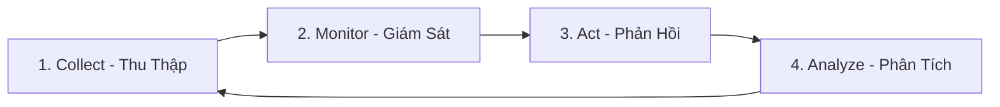
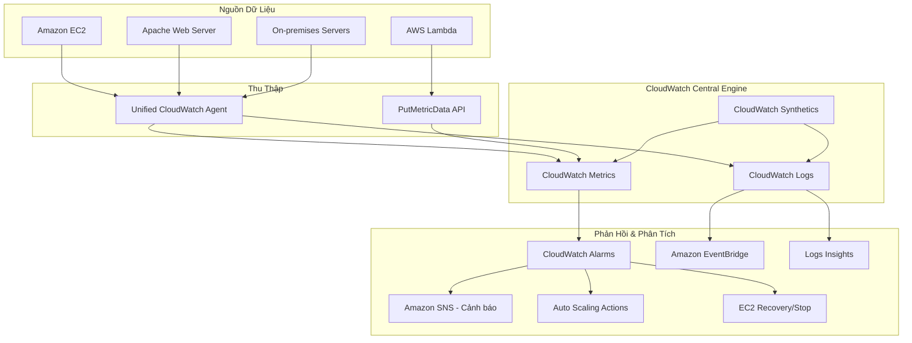

# Khởi Đầu Với Amazon CloudWatch (Amazon CloudWatch Getting Started)
**Chủ đề (Topic):** Observability & Operations  
**Khóa học (Course):** Amazon CloudWatch Getting Started  

---

## MODULE 1: Giới Thiệu Về Amazon CloudWatch & Kiến Trúc Observability

### 1.1 Khái Niệm Observability (Khả Năng Quan Sát)
Trong hệ thống đám mây hiện đại, **Observability (Khả năng quan sát)** vượt xa khái niệm giám sát (Monitoring) truyền thống. Trong khi Monitoring cho biết *khi nào* hệ thống gặp sự cố (ví dụ: máy chủ bị sập), Observability giúp chúng ta hiểu được *tại sao* sự cố đó xảy ra bằng cách phân tích dữ liệu đầu ra của hệ thống. 

AWS Observability được xây dựng trên một quy trình khép kín gồm **4 Giai đoạn Cốt lõi (Observability Lifecycle)**:



1. **Collect (Thu thập)**: Thu thập Metrics, Logs và Traces từ tất cả các tài nguyên hạ tầng, ứng dụng và mạng (sử dụng CloudWatch Agent, AWS SDKs, hoặc tích hợp dịch vụ gốc).
2. **Monitor (Giám sát)**: Trực quan hóa dữ liệu trên Dashboards thời gian thực để thiết lập các đường cơ sở vận hành (operational baselines).
3. **Act (Phản hồi/Khắc phục)**: Tự động hóa các hành động ứng phó sự cố thông qua hệ thống cảnh báo (Alarms) hoặc quy trình co giãn tự động (Auto Scaling).
4. **Analyze (Phân tích)**: Sử dụng các công cụ truy vấn nâng cao (như Logs Insights, Metric Math, hoặc ServiceLens) để phân tích nguyên nhân gốc rễ (Root Cause Analysis - RCA).

---

### 1.2 Amazon CloudWatch Là Gì?
**Amazon CloudWatch** là dịch vụ giám sát và quản lý tài nguyên đám mây chính yếu của AWS, cung cấp khả năng hiển thị toàn diện về sức khỏe hệ thống, hiệu suất ứng dụng và mức độ sử dụng tài nguyên. 

CloudWatch hoạt động như một kho lưu trữ dữ liệu trung tâm thu thập dữ liệu từ hơn 70 dịch vụ AWS khác nhau cũng như các ứng dụng chạy trên EC2 hoặc môi trường on-premises.

#### 5 Thành Phần Cốt Lõi Của CloudWatch:

| Thành Phần | Chức Năng Chính | Dữ Liệu Xử Lý |
| :--- | :--- | :--- |
| **Metrics** | Đo lường hiệu suất hệ thống theo chuỗi thời gian (time-series). | CPU, Memory, Network, Disk I/O, API Request latency. |
| **Logs** | Lưu trữ, tìm kiếm và phân tích các tệp nhật ký hệ thống và ứng dụng. | Apache logs, Windows Event logs, Lambda execution logs. |
| **Alarms** | Kích hoạt cảnh báo hoặc hành động tự động dựa trên ngưỡng metrics. | SNS notifications, EC2 Auto Scaling, Instance recovery. |
| **Events (EventBridge)** | Phát hiện thay đổi trạng thái tài nguyên và định tuyến tới các target tự động. | EC2 Instance state change, S3 bucket upload triggers. |
| **Synthetics** | Giả lập hành vi người dùng cuối (canaries) để giám sát bên ngoài (outside-in). | Endpoint availability, API latency, UI broken links. |

---

### 1.3 Kiến Trúc Luồng Dữ Liệu CloudWatch (Data Flow Architecture)
Kiến trúc dưới đây minh họa cách dữ liệu được tổng hợp từ nhiều nguồn khác nhau, xử lý tập trung trong CloudWatch và kích hoạt các phản hồi tự động:



---

## MODULE 2: Giám Sát Metrics Mặc Định Và Metrics Tùy Chỉnh

### 2.1 Metrics Mặc Định (Default Metrics) Của Amazon EC2
Khi bạn khởi chạy một Amazon EC2 instance, hypervisor của AWS sẽ tự động thu thập và gửi các chỉ số hiệu suất phần cứng lên CloudWatch mà không cần cài đặt thêm phần mềm nào. 

#### Các Chỉ Số Mặc Định Quan Trọng:
* `CPUUtilization`: Phần trăm công suất CPU đang được sử dụng trên instance.
* `NetworkIn` / `NetworkOut`: Số lượng byte dữ liệu mà instance nhận/gửi đi trên tất cả các network interface.
* `DiskReadBytes` / `DiskWriteBytes`: Số lượng byte đọc/ghi trực tiếp từ các ổ đĩa instance store hoặc EBS volumes đính kèm (chỉ áp dụng với một số dòng instance cụ thể).
* `StatusCheckFailed`: Cho biết instance có vượt qua hai bài kiểm tra sức khỏe vật lý (`StatusCheckFailed_System` - lỗi hạ tầng phần cứng của AWS) và sức khỏe hệ điều hành (`StatusCheckFailed_Instance` - lỗi cấu hình phần mềm hoặc OS crash).

#### Chu Kỳ Thu Thập (Resolution Period):
* **Basic Monitoring (Mặc định - Miễn phí)**: Dữ liệu metric được gửi lên CloudWatch với tần suất **5 phút** một lần.
* **Detailed Monitoring (Trả phí)**: Kích hoạt tần suất thu thập nâng cao **1 phút** một lần. Điều này cực kỳ quan trọng đối với các hệ thống Auto Scaling cần phản ứng nhanh với sự thay đổi của traffic.

---

### 2.2 Điểm Mù Của Default Metrics & Sự Cần Thiết Của Custom Metrics
Mặc dù default metrics cung cấp cái nhìn tổng quan về hạ tầng phần cứng vật lý, chúng hoàn toàn **bị mù** đối với trạng thái bên trong hệ điều hành (OS-level metrics). 

> [!IMPORTANT]
> **Bộ nhớ RAM (Memory Utilization)** và **Dung lượng đĩa ảo (Disk Space Utilization / Disk Free)** **KHÔNG** thể được thu thập bởi hypervisor của AWS vì lý do ranh giới bảo mật và kiến trúc ảo hóa. 

Để giám sát RAM hoặc Disk Space của EC2 instance, bắt buộc phải cài đặt **Unified CloudWatch Agent** bên trong hệ điều hành để đọc trực tiếp các thông số OS và đẩy dữ liệu lên CloudWatch dưới dạng **Custom Metrics**.

---

### 2.3 Quản Lý Custom Metrics
Bất kỳ metric nào bạn tự định nghĩa và gửi lên CloudWatch không thông qua cơ chế mặc định của dịch vụ AWS đều được coi là Custom Metric.

#### Phương Thức Đẩy Custom Metrics:
1. **API Call**: Sử dụng lệnh CLI `aws cloudwatch put-metric-data` hoặc SDKs (Boto3, Java SDK,...) để gửi dữ liệu định dạng JSON.
2. **CloudWatch Agent**: Cấu hình tự động đẩy các chỉ số hệ thống (RAM, CPU core, Disk partition) lên CloudWatch theo định kỳ.

#### Độ Phân Giải (Resolution):
* **Standard Resolution**: Dữ liệu có độ phân giải tối thiểu là **1 phút** (mặc định, `--storage-resolution 60`).
* **High-Resolution**: Dữ liệu có độ phân giải lên tới **1 giây** (`--storage-resolution 1`). Hữu ích cho việc giám sát các chỉ số cực kỳ nhạy cảm và cần phản ứng tức thì (ví dụ: latency của các giao dịch thanh toán). Bạn phải trả thêm phí cho High-Resolution metrics.

#### Tình Huống "Publish Custom Metric Với Granularity 1 Giây" (2 điều kiện phải thỏa ĐỒNG THỜI)
Câu hỏi dạng này ngầm có 2 yêu cầu khác nhau, mỗi đáp án lo một việc — thiếu một trong hai là không đạt:

1. **Dùng AWS CLI (hoặc SDK/API) để publish** → trả lời cho "làm sao đưa được metric lên":
   * CloudWatch **KHÔNG cho tạo custom metric từ Console** — không có nút bấm nào trên web.
   * Custom metric chỉ đẩy lên được qua API **`PutMetricData`**, gọi qua CLI (`aws cloudwatch put-metric-data`) hoặc SDK (Boto3, Java SDK...).
2. **Bật High Resolution (`--storage-resolution 1`)** → trả lời cho "làm sao đạt 1 giây":
   * Mặc định custom metric là standard = **60 giây**. Publish bình thường không thể có 1 giây.
   * Chỉ high resolution mới cho granularity **1 giây**.

```
aws cloudwatch put-metric-data --namespace TutorialsDojo/Sensors \
  --metric-name TempHiRes --value 30 --storage-resolution 1 --region ap-southeast-1
```

#### Phân Biệt "Storage Resolution" Với "Tần Suất Gửi" (dễ nhầm)
High resolution là một **thuộc tính của metric** (bật qua tham số `--storage-resolution 1`), KHÔNG tự động gửi dữ liệu giúp bạn:

* **Storage resolution** = CloudWatch **lưu** dữ liệu ở mức chi tiết 1 giây. Đây là cái tham số quyết định.
* **Tần suất publish** = bạn tự quyết định gửi bao nhiêu lần. High resolution chỉ **cho phép** lưu tới 1 giây; muốn thật sự có 1 điểm mỗi giây thì **script/ứng dụng của bạn phải gọi `put-metric-data` mỗi giây** (hoặc gửi batch nhiều điểm kèm timestamp cách nhau 1 giây).

#### Period Đọc Được Theo Resolution
| | Standard (mặc định) | High Resolution |
|---|---|---|
| Granularity lưu trữ | 60 giây | 1 giây |
| Tham số | `--storage-resolution 60` (hoặc bỏ trống) | `--storage-resolution 1` |
| Period đọc được | bội số của 60 giây | 1, 5, 10, 30 giây hoặc bội số 60 |
| Chi phí | Thấp hơn | Cao hơn |
| Dùng khi | Theo dõi thông thường | Phát hiện spike vài giây, auto scaling phản ứng nhanh |

> **High-resolution alarm**: alarm trên metric high resolution có thể đặt period **10 hoặc 30 giây** → phản ứng nhanh hơn alarm thường (tối thiểu 60 giây), đánh đổi bằng chi phí cao hơn.

---

### 2.4 Thống Kê Metrics (CloudWatch Statistics)
Khi hiển thị metrics trên biểu đồ hoặc thiết lập Alarms, bạn cần chỉ định cách CloudWatch tổng hợp dữ liệu trong một khoảng thời gian (Period). Các hàm thống kê chính bao gồm:

* **Average (Trung bình)**: Tổng giá trị chia cho số lượng mẫu. Hữu ích cho việc theo dõi xu hướng tổng thể như `CPUUtilization`.
* **Sum (Tổng)**: Cộng dồn tất cả các giá trị nhận được. Thường dùng cho các metric dạng đếm số lượng như `VolumeReadBytes` hoặc số lượng HTTP Requests.
* **SampleCount (Số lượng mẫu)**: Số lượng dữ liệu được gửi về. Dùng để kiểm tra tần suất hoạt động của agent hoặc số lượng log event.
* **Minimum / Maximum**: Giá trị thấp nhất/cao nhất trong khoảng thời gian. Hữu ích để tìm ra các điểm đột biến hiệu năng cực đại (Spikes).
* **Percentiles (Phân vị - ví dụ: p90, p95, p99)**: Cho biết giá trị mà tại đó một tỷ lệ phần trăm các mẫu dữ liệu thấp hơn nó. 
  * *Ứng dụng*: Để đo lường trải nghiệm khách hàng về độ trễ ứng dụng (Latency), không bao giờ nên dùng **Average** vì các yêu cầu cực kỳ chậm của 1% khách hàng sẽ bị cào bằng. Hãy dùng **p99** để giám sát xem 1% người dùng đang gặp phải độ trễ tồi tệ nhất là bao nhiêu.

---

### 2.5 Hai Luồng Đẩy Metric & Vai Trò Của IAM Instance Profile (lab d1-02)
Đây là điểm cực kỳ dễ nhầm: không phải mọi metric của EC2 đều cần CloudWatch Agent, và không phải mọi metric đều cần IAM permission trên instance. Có **hai luồng dữ liệu hoàn toàn tách biệt**.

#### Luồng 1: Default Metrics — Qua Hypervisor, KHÔNG Cần Agent, KHÔNG Cần IAM
Các metric mặc định (`CPUUtilization`, `NetworkIn/Out`, `DiskReadOps`, `StatusCheckFailed`...) do **hypervisor của AWS** đẩy thẳng lên CloudWatch, nằm trong namespace `AWS/EC2`. Luồng này đi **bên ngoài hệ điều hành** của instance.

> [!IMPORTANT]
> Default metrics KHÔNG chạy qua agent, KHÔNG chạy qua IAM role của instance, và KHÔNG cần bất kỳ permission nào trên instance profile. Kể cả instance không gắn IAM role nào, `CPUUtilization` vẫn lên CloudWatch bình thường.

#### Luồng 2: Custom Metrics & Logs — Qua Agent, BẮT BUỘC Cần IAM Permission
Memory, disk used %, swap và application metrics/logs phải do **Unified CloudWatch Agent** đọc từ bên trong OS rồi gọi API đẩy lên. Khi gọi API, agent dùng credential lấy từ **IAM Instance Profile** gắn trên instance. Thiếu permission thì agent vẫn chạy nhưng không đẩy được gì lên.

```
Default metrics (AWS/EC2 namespace)
┌──────────────────┐
│  AWS Hypervisor  │ ──────────► CloudWatch   (KHÔNG qua OS, KHÔNG qua IAM role)
└──────────────────┘

Custom/app metrics + logs (CWAgent namespace hoặc tùy config)
┌─────────────────────────────┐
│ EC2 instance                │
│  ┌───────────────────────┐  │
│  │ Unified CloudWatch    │  │   dùng credential từ
│  │ Agent (đọc OS/app)    │──┼──► IAM Instance Profile ──► CloudWatch
│  └───────────────────────┘  │   (PutMetricData, PutLogEvents)
└─────────────────────────────┘
```

#### IAM Permission Cần Cho Agent
AWS có sẵn managed policy `CloudWatchAgentServerPolicy`, gắn vào role của instance profile là đủ cho hầu hết lab. Các quyền chính:

| Quyền | Dùng để |
| :--- | :--- |
| `cloudwatch:PutMetricData` | Đẩy custom metric (RAM, disk, swap...) |
| `logs:CreateLogGroup`, `logs:CreateLogStream` | Tạo log group/stream lần đầu |
| `logs:PutLogEvents`, `logs:DescribeLogStreams` | Đẩy log event lên CloudWatch Logs |
| `ssm:GetParameter` | Đọc file config agent nếu lưu ở SSM Parameter Store |

#### Bảng Tổng Hợp (chốt lại cho exam)
| Loại metric | Cần CloudWatch Agent? | Cần IAM permission trên instance? | Namespace |
| :--- | :--- | :--- | :--- |
| EC2 default (CPU, Network, Disk Ops, StatusCheck) | Không | Không | `AWS/EC2` |
| Memory, disk used %, swap | Có | Có | `CWAgent` (mặc định) |
| Application metrics / logs | Có | Có | Tùy config |

> **Memory tip (SOA-C03):** thấy câu hỏi nhắc tới "memory utilization" hoặc "disk space used" thì gần như chắc chắn đáp án dính tới việc cài **CloudWatch Agent** + gắn **`CloudWatchAgentServerPolicy`** vào IAM role. Bẫy thường gặp: đáp án nói "chỉ cần bật Detailed Monitoring" là SAI, vì Detailed Monitoring chỉ hạ chu kỳ default metric từ 5 phút xuống 1 phút, KHÔNG thêm được RAM/disk.

---

## MODULE 3: Thu Thập Và Truy Vấn Log Apache Với CloudWatch Logs

### 3.1 Cấu Trúc Thành Phần CloudWatch Logs
Môi trường CloudWatch Logs tổ chức dữ liệu nhật ký theo cấu trúc phân cấp chặt chẽ:

```
[CloudWatch Logs Region]
       └── [Log Group] (ví dụ: /aws/ec2/apache-production)
                 ├── [Log Stream 1] (ví dụ: i-0abc123456789def0-access)
                 ├── [Log Stream 2] (ví dụ: i-0abc123456789def0-error)
                 └── [Log Stream 3] (ví dụ: i-0xyz987654321cba1-access)
```

1. **Log Group (Nhóm Log)**: Tập hợp các log stream có chung cấu hình quản trị, chính sách bảo mật và thời gian lưu trữ (retention policy). Ví dụ: bạn có thể tạo một Log Group chuyên dụng cho toàn bộ Access Log của hệ thống Apache Server.
2. **Log Stream (Luồng Log)**: Chuỗi các log event đến từ cùng một nguồn cụ thể (ví dụ: một file log cụ thể trên một EC2 instance xác định). Thường được đặt tên theo `InstanceID` để dễ phân biệt.
3. **Log Event (Sự kiện Log)**: Một dòng log ghi nhận hoạt động kèm theo dấu thời gian (timestamp) và thông điệp log gốc (raw message).

---

### 3.1b Unified CloudWatch Agent Là Gì Và Thu Thập Được Gì (Agent Overview)

**Unified CloudWatch Agent** là một software component chạy liên tục, tự động trên server, dùng để thu thập **metrics, logs và traces** từ EC2 instance, **on-premises server** và **containerized application**. Nó cho phép giám sát hạ tầng và ứng dụng sâu hơn nhiều so với basic monitoring mặc định.

#### Agent làm được gì
| Khả năng | Chi tiết |
| :--- | :--- |
| System-level metrics của EC2 (kể cả in-guest) | Thu thập metric nội bộ OS (RAM, disk used %, swap...) mà default EC2 metrics không có. Danh sách ở "Metrics collected by the CloudWatch agent". |
| Metrics từ on-premises server | Chạy được trên server hybrid và cả server không do AWS quản lý. |
| Custom metrics từ app | Qua giao thức **StatsD** (Linux + Windows) và **collectd** (chỉ Linux). |
| Logs từ EC2 và on-premises | Hỗ trợ cả **Linux lẫn Windows Server**. (Lưu ý: agent KHÔNG hỗ trợ đọc log từ FIFO pipe.) |
| **Traces** | Từ bản **1.300025.0+**, thu thập trace từ OpenTelemetry hoặc X-Ray SDK rồi gửi X-Ray, **không cần chạy daemon trace riêng**. |
| Gửi metric tới Prometheus | Tham số `metrics_destinations` cho chọn `cloudwatch`, `amp` (Amazon Managed Service for Prometheus), hoặc cả hai. |

> [!IMPORTANT]
> Agent thu thập được **cả ba trụ cột observability**: metrics, logs, traces. Đây là bản hợp nhất ("unified") thay thế CloudWatch Logs agent cũ và plugin `aws:cloudWatch` của SSM Agent (đã deprecated). Luôn dùng unified agent cho thu thập log/metric mới.

> [!IMPORTANT]
> Namespace mặc định cho metric agent publish là **`CWAgent`** (đổi được trong config). Agent là nền tảng của **Luồng 2** đã mô tả ở mục 2.5: mọi thứ agent đẩy lên đều cần IAM permission (`CloudWatchAgentServerPolicy`).

> **Memory tip (SOA-C03):** câu hỏi kiểu "thu thập log từ **on-premises server** / server hybrid lên CloudWatch" -> đáp án là **CloudWatch Agent** (chạy được ngoài AWS), không phải cơ chế hypervisor. Thấy "collect traces + giảm số agent phải quản lý" -> dùng **CloudWatch Agent thu trace thẳng về X-Ray**, khỏi chạy X-Ray daemon riêng.

**Nguồn (Sources) cho mục 3.1b:**
- [Collect metrics, logs, and traces using the CloudWatch agent](https://docs.aws.amazon.com/AmazonCloudWatch/latest/monitoring/Install-CloudWatch-Agent.html)

#### "Unified CloudWatch Agent" vs "CloudWatch agent": CÓ PHẢI 2 BẢN KHÁC NHAU?

**Không.** Chỉ có **một agent hiện hành**. "Unified CloudWatch Agent" là tên chính thức, "CloudWatch agent" là cách gọi tắt **cùng một thứ**. Chúng không phải hai bản để chọn.

Cái gây nhầm là có các agent **đời cũ đã bị thay thế**:

| Tên | Thực chất | Trạng thái |
| :--- | :--- | :--- |
| **Unified CloudWatch Agent** | Một phần mềm làm cả metric + log + trace | Bản hiện tại, AWS khuyến nghị |
| **CloudWatch Logs agent** (`awslogs`) | Agent đời cũ, **chỉ đẩy log** | Deprecated, không còn hỗ trợ |
| SSM Agent plugin `aws:cloudWatch` | Plugin cũ gửi log qua SSM Agent | Deprecated, bị unified agent thay |

Chữ "unified" (hợp nhất) ra đời vì trước kia phải cài **nhiều agent riêng**: awslogs cho log, cơ chế khác cho metric. AWS gộp lại thành một.

```
Trước kia (nhiều agent):            Bây giờ (một agent):
┌────────────────┐
│ awslogs agent  │ → chỉ log        ┌──────────────────────────┐
├────────────────┤                  │ Unified CloudWatch Agent │
│ agent metric   │ → chỉ metric     │  metric + log + trace    │
└────────────────┘                  └──────────────────────────┘
   (deprecated)                         (dùng cái này)
```

> [!IMPORTANT]
> Tên gói trên instance là `amazon-cloudwatch-agent` (thư mục `/opt/aws/amazon-cloudwatch-agent/`, lệnh `amazon-cloudwatch-agent-ctl`). Tên gói **không chứa chữ "unified"** nhưng chính là Unified CloudWatch Agent. "Unified" là khái niệm trong tài liệu, không nằm trong tên gói.

> [!IMPORTANT]
> Dùng **IMDSv2** thì BẮT BUỘC dùng Unified CloudWatch Agent. Agent `awslogs` đời cũ không hỗ trợ IMDSv2.

> **Memory tip (SOA-C03):** chỉ còn **một** agent hiện hành = **Unified CloudWatch Agent** (metric + log + trace). Thấy đề nhắc "CloudWatch Logs agent" cũ, "awslogs", hay plugin `aws:cloudWatch` của SSM -> đó là bản **deprecated**, đáp án đúng gần như luôn là chuyển sang **unified agent**.

---

### 3.2 Cấu Hình Unified CloudWatch Agent Thu Thập Apache Logs
Để đẩy log từ Apache Web Server (thường nằm ở đường dẫn `/var/log/apache2/` trên Ubuntu hoặc `/var/log/httpd/` trên CentOS/RedHat) lên CloudWatch, chúng ta sử dụng **Unified CloudWatch Agent**.

#### Cấu Hình File `amazon-cloudwatch-agent.json`:
Tệp cấu hình dưới đây hướng dẫn Agent đọc đồng thời cả Access Log và Error Log của Apache, sau đó gửi về hai Log Group riêng biệt:

```json
{
  "agent": {
    "metrics_collection_interval": 60,
    "run_as_user": "cwagent"
  },
  "logs": {
    "logs_collected": {
      "files": {
        "collect_list": [
          {
            "file_path": "/var/log/apache2/access.log",
            "log_group_name": "/webserver/apache/access_log",
            "log_stream_name": "{instance_id}-access",
            "retention_in_days": 30
          },
          {
            "file_path": "/var/log/apache2/error.log",
            "log_group_name": "/webserver/apache/error_log",
            "log_stream_name": "{instance_id}-error",
            "retention_in_days": 90
          }
        ]
      }
    }
  }
}
```

---

### 3.3 Truy Vấn Logs Nâng Cao Với CloudWatch Logs Insights
**CloudWatch Logs Insights** cung cấp một ngôn ngữ truy vấn mạnh mẽ (Logs Insights QL) giúp phân tích hàng triệu dòng log chỉ trong vài giây.

#### Các Lệnh Truy Vấn Cốt Lõi:
* `fields`: Chỉ định các cột dữ liệu hiển thị (ví dụ: `@timestamp`, `@message`).
* `filter`: Lọc các dòng log thỏa mãn điều kiện (sử dụng toán tử so sánh, `like`, hoặc regex).
* `parse`: Trích xuất dữ liệu có cấu trúc từ thông điệp log thô (`@message`).
* `stats`: Thực hiện các hàm tính toán tổng hợp (`count()`, `avg()`, `sum()`, `count_distinct()`) gom nhóm theo khoảng thời gian (`bin()`) hoặc theo trường dữ liệu.
* `sort`: Sắp xếp kết quả theo thứ tự tăng/giảm dần (`asc`/`desc`).
* `limit`: Giới hạn số lượng bản ghi hiển thị.

---

### 3.4 Ví Dụ Truy Vấn Thực Tế Cho Apache Logs

#### Ví dụ 1: Tìm kiếm các truy cập vào thư mục nhạy cảm `/admin`
Truy vấn này tìm kiếm toàn bộ các yêu cầu HTTP có chứa từ khóa "/admin" trong đường dẫn request, sắp xếp theo thời gian mới nhất:

```sql
fields @timestamp, @message
| filter @message like "/admin"
| sort @timestamp desc
| limit 20
```

#### Ví dụ 2: Sử Dụng Lệnh `parse` Để Đọc Log Apache Chưa Cấu Trúc
Hầu hết Apache Access Logs sử dụng định dạng **Combined Log Format** có dạng chuỗi thô:
`192.168.1.50 - - [20/May/2026:20:15:30 +0700] "GET /index.html HTTP/1.1" 200 4526 "http://example.com/" "Mozilla/5.0..."`

Để trích xuất các trường thông tin cụ thể phục vụ tính toán, chúng ta sử dụng lệnh `parse` với mẫu Glob:

```sql
parse @message "* - - [*] \"* * *\" * * \"*\" \"*\"" as ip, timestamp, method, url, protocol, status, bytes, referrer, useragent
| filter status = "200" and method = "GET"
| stats count() as SuccessGetRequests by url
| sort SuccessGetRequests desc
| limit 10
```

#### Ví dụ 3: Đếm số lượng khách truy cập duy nhất (Unique Visits)
Truy vấn dưới đây phân tích log, trích xuất IP khách hàng và đếm số lượng IP duy nhất truy cập vào trang chủ:

```sql
parse @message "* - - [*] \"* * *\" * *" as ip, timestamp, method, url, protocol, status, bytes
| filter status = "200" and url = "/"
| stats count_distinct(ip) as UniqueVisits
```

#### Ví dụ 4: Biểu đồ hóa tỷ lệ lỗi HTTP 4xx và 5xx theo thời gian (Thời gian gom nhóm 5 phút)
Giúp quản trị viên phát hiện ngay lập tức các đợt bùng phát lỗi hệ thống thông qua dạng biểu đồ trực quan (Visualization):

```sql
parse @message "* - - [*] \"* * *\" * *" as ip, timestamp, method, url, protocol, status, bytes
| filter status >= 400
| stats count() as ErrorCount by bin(5m)
| sort bin(5m) asc
```

---

### 3.5 Khắc Phục Sự Cố: Unified CloudWatch Agent Không Đẩy Được Log Events

Khi agent chạy (`status: running`) nhưng log group không nhận được event, nguyên nhân rơi vào các nhóm sau. Agent dùng API `PutLogEvents` để đẩy log, nên hầu hết lỗi nằm ở cấu hình, mạng, IAM hoặc timestamp.

| Nguyên nhân | Dấu hiệu / Cách kiểm tra | Cách khắc phục |
| :--- | :--- | :--- |
| **Metadata lệch do tạo AMI sau khi cài agent** | Nhiều instance tạo từ cùng AMI đẩy trùng/sai stream; agent "nhớ" metadata của instance gốc | AMI chỉ chứa agent tới thời điểm tạo ảnh. Phải có quy trình cập nhật agent và **lấy lại config khi instance khởi động** (user data script hoặc SSM Distributor/State Manager). KHÔNG lưu AWS credential trong AMI, dùng IAM role. |
| **Agent phiên bản cũ** | Agent cài sẵn trong AMI lỗi thời | Cập nhật lên bản agent mới nhất. Dùng SSM Distributor hoặc user data script update khi provision. |
| **Không kết nối được tới CloudWatch Logs endpoint** | Log không lên dù IAM đủ quyền | Kiểm tra internet/route ra ngoài (NAT, IGW) hoặc **VPC endpoint cho `logs`** nếu private subnet. Kiểm tra Security Group, Network ACL cho phép outbound HTTPS 443. |
| **Sai account / Region / log group trong config** | Log lên nhầm chỗ hoặc không thấy | Soát lại `config.json`: đúng Region, đúng `log_group_name`. Agent đẩy về Region cấu hình, không phải Region của instance mặc định. |
| **Thiếu quyền IAM** | Agent chạy nhưng không tạo được log group/stream | Gắn `CloudWatchAgentServerPolicy` vào instance profile. Cần `logs:CreateLogGroup`, `logs:CreateLogStream`, `logs:PutLogEvents`. (Liên hệ mục 2.5: đẩy log là Luồng 2, bắt buộc IAM.) |
| **Lỗi khi agent chạy (agent run errors)** | `amazon-cloudwatch-agent-ctl -a status` không `running` | Xem log của agent: Linux `/opt/aws/amazon-cloudwatch-agent/logs/amazon-cloudwatch-agent.log`; Windows `$Env:ProgramData\Amazon\AmazonCloudWatchAgent\Logs\...`. Nếu dùng `run_as_user`, kiểm tra user đó có quyền đọc file log nguồn. Bật `debug` trong config để log chi tiết. Lỗi IMDS: kiểm tra truy cập được metadata endpoint, firewall/route không chặn. |
| **Timestamp issue** | Agent log: *"out of accepted time range. Discard the log entry"* hoặc *"log events ... are expired"* | CloudWatch từ chối event **quá 2 giờ trong tương lai** hoặc **quá 14 ngày trong quá khứ** (và event trước retention của log group). Thêm `timestamp_format` đúng vào config để agent parse đúng mốc thời gian trong dòng log. Bỏ `timestamp_format` thì agent dùng thời gian hiện tại. Restart agent sau khi sửa. |

> [!IMPORTANT]
> Giới hạn timestamp của `PutLogEvents` (xác thực từ docs): từ chối log có timestamp **> 2 giờ ở tương lai** hoặc **> 14 ngày ở quá khứ**. Đây là lý do một server lệch giờ (NTP sai) hoặc `timestamp_format` cấu hình sai khiến log bị "Discard" dù mọi thứ khác đúng.

> **Memory tip (SOA-C03):** "agent running nhưng log không lên" -> lần lượt loại trừ theo thứ tự rẻ tới đắt: (1) IAM thiếu `CloudWatchAgentServerPolicy`, (2) đọc agent log file tìm lỗi, (3) network tới endpoint (private subnet thiếu VPC endpoint/NAT), (4) sai Region/log group trong config, (5) timestamp ngoài dải chấp nhận. Thấy chữ "Discard the log entry" hay "out of accepted time range" trong đề -> đáp án là **timestamp** (sửa `timestamp_format` hoặc đồng bộ NTP).

**Nguồn (Sources) cho mục 3.5:**
- [Why doesn't my unified CloudWatch agent send log events?](https://repost.aws/knowledge-center/cloudwatch-push-logs-with-unified-agent)
- [How do I use the unified CloudWatch agent to resolve log timestamp errors?](https://repost.aws/knowledge-center/cloudwatch-timestamp-errors)
- [Including the CloudWatch agent in your AMIs](https://docs.aws.amazon.com/prescriptive-guidance/latest/implementing-logging-monitoring-cloudwatch/including-the-cloud-watch-agent-in-your-am-is.html)

---

## MODULE 4: Thiết Lập CloudWatch Alarms & Tự Động Hóa Phản Hồi

### 4.1 Các Trạng Thái Của CloudWatch Alarm
Một Alarm giám sát một chỉ số duy nhất (hoặc kết quả của phép toán Metric Math). Tại mọi thời điểm, Alarm sẽ ở một trong ba trạng thái sau:

```
                  ┌────────────────────────┐
                  │           OK           │ (Chỉ số hoạt động bình thường dưới ngưỡng)
                  └───────────┬────────────┘
                              │
            Vượt ngưỡng       │      Dưới ngưỡng
         ─────────────────────┼─────────────────────
                              ▼
                  ┌────────────────────────┐
                  │         ALARM          │ (Chỉ số vượt quá ngưỡng quy định)
                  └───────────┬────────────┘
                              │
          Mất dữ liệu        │      Có dữ liệu trở lại
         ─────────────────────┼─────────────────────
                              ▼
                  ┌────────────────────────┐
                  │    INSUFFICIENT_DATA   │ (Không đủ dữ liệu hoặc mất kết nối từ Agent)
                  └────────────────────────┘
```

* **OK**: Chỉ số đo lường đang hoạt động bình thường, nằm trong phạm vi an toàn cho phép.
* **ALARM**: Chỉ số đã vượt quá ngưỡng cấu hình và số chu kỳ đánh giá yêu cầu đã đạt giới hạn.
* **INSUFFICIENT_DATA**: Dịch vụ CloudWatch không nhận đủ dữ liệu để đưa ra quyết định đánh giá trạng thái (ví dụ: instance bị tắt đột ngột, Agent bị crash hoặc metric mới được tạo chưa có dữ liệu lịch sử).

---

### 4.2 Static Thresholds Vs. Anomaly Detection Alarms
CloudWatch hỗ trợ hai phương thức đánh giá ngưỡng cảnh báo:

#### 1. Static Thresholds (Ngưỡng Tĩnh):
* **Cơ chế**: Người dùng tự cấu hình một con số cố định (ví dụ: CPU > 85%).
* **Ưu điểm**: Đơn giản, rõ ràng, dễ thiết lập.
* **Nhược điểm**: Không linh hoạt đối với các hệ thống có đặc tính traffic thay đổi theo giờ cao điểm (ví dụ: CPU luôn cao vào 12h trưa nhưng rất thấp vào 12h đêm).

#### 2. Anomaly Detection Alarms (Phát Hiện Bất Thường Dựa Trên Machine Learning):
* **Cơ chế**: CloudWatch tự động phân tích dữ liệu lịch sử của metric trong tối thiểu 14 ngày để huấn luyện mô hình Machine Learning, từ đó tự động vẽ ra một **dải băng hoạt động bình thường (expected behavior band)**. Ngưỡng cảnh báo sẽ tự động co giãn theo thời gian thực.
* **Ưu điểm**: Giảm thiểu tối đa báo động giả (alert fatigue). Ví dụ: CPU tăng cao vào trưa thứ 2 hàng tuần được coi là bình thường và không kích hoạt cảnh báo, nhưng nếu CPU đột ngột tăng cao vào đêm chủ nhật, hệ thống sẽ gắn cờ ALARM ngay lập tức.
* **Cấu hình**: Người dùng cấu hình chỉ số **Standard Deviation (Độ lệch chuẩn)**—dải băng càng rộng thì độ nhạy cảnh báo càng thấp.

```
Metric Value
  ^
  │      /───\  <- expected upper band limit (Dải băng trên)
  │    /  *    \
  │   │  * *    │  <- * * * actual metric values (Dữ liệu thực tế)
  │    \  *    /
  │      \───/  <- expected lower band limit (Dải băng dưới)
  └──────────────────────────────────────────────────────────> Time
```

---

### 4.3 Giảm Thiểu Báo Động Giả Với "Evaluation Periods" Và "Datapoints to Alarm"
Để tránh việc các đỉnh nhọn bất thường diễn ra trong tích tắc (Spikes) kích hoạt cảnh báo nhầm, bạn cần hiểu 3 tham số đi cùng nhau:

* **Period**: Mỗi datapoint đại diện cho bao lâu. Ví dụ Period = 1 phút → cứ mỗi 1 phút CloudWatch có 1 datapoint của metric.
* **Evaluation Periods (M)**: Số datapoint gần nhất mà CloudWatch nhìn vào để đánh giá. Ví dụ M = 3 → nhìn 3 datapoint gần nhất.
* **Datapoints to Alarm (N)**: Trong M datapoint đó, cần bao nhiêu điểm vượt ngưỡng thì Alarm mới chuyển sang ALARM.

> Cú pháp hiển thị trên Console là **"N out of M"** (Datapoints to Alarm = N, Evaluation Periods = M). Lưu ý đọc đúng thứ tự: **N là số điểm vi phạm cần có**, **M là tổng số điểm nhìn vào**.

#### Ví dụ "3 out of 3" (bài lab d1-01, alarm `td-cpu-80`, Period 1 phút)
Nhìn vào **3 datapoint gần nhất** (= 3 phút gần nhất) và cần **cả 3** đều vượt ngưỡng CPU > 80% thì mới vào ALARM.

| Phút | CPU | Vượt 80%? | Kết quả |
|---|---|---|---|
| 1, 2, 3 | 85%, 90%, 88% | ✓ ✓ ✓ | **ALARM** (đủ 3/3) |
| 1, 2, 3 | 85%, 70%, 88% | ✓ ✗ ✓ | OK (chỉ 2/3) |

→ Nếu CPU chỉ tăng vọt 1 phút rồi tụt (spike nhất thời) thì Alarm vẫn OK. CPU phải cao **liên tục 3 phút** mới báo động → giảm nhiễu.

#### Phân biệt N = M và N < M
* **N = M** (ví dụ `3 out of 3`): phải vi phạm **liên tục** cả M chu kỳ → nghiêm ngặt nhất, ít false alarm nhất.
* **N < M** (ví dụ `2 out of 3`): chỉ cần N trong M chu kỳ vi phạm, không cần liên tiếp → nhạy hơn, hợp với metric dao động mạnh (như network) để không bỏ sót vấn đề thật chỉ vì 1 phút tụt xuống.

> Chính nhờ chênh lệch N/M giữa các alarm mà ta kiểm soát được cái nào kích hoạt trước. Ví dụ trong lab: alarm Recover đặt `2 out of 2` (kích hoạt sau 2 phút) còn alarm Reboot đặt `3 out of 3` (sau 3 phút) → Recover ra tay trước, tránh tranh chấp khi cả hai cùng theo dõi một instance.

---

### 4.4 Các Hành Động Tự Động Hóa Của Alarm (Alarm Actions)
Khi Alarm chuyển trạng thái (thường là chuyển sang ALARM hoặc quay về OK), nó có thể kích hoạt các hành động tự động:

1. **Amazon SNS Notifications**: Gửi thông điệp cảnh báo tới một SNS Topic để chuyển tiếp thành Email, SMS, hoặc tích hợp với các công cụ vận hành như Slack, Teams, PagerDuty, Opsgenie.
2. **EC2 Auto Scaling Actions**: Kích hoạt chính sách Dynamic Scaling để tự động thêm instance (Scale-out) khi hệ thống quá tải hoặc giảm bớt instance (Scale-in) khi hệ thống nhàn rỗi.
3. **Systems Manager OpsCenter**: Tự động tạo ra các OpsItems để đội ngũ kỹ sư trực ca xử lý theo quy trình chuẩn hóa.
4. **EC2 Actions**: Các hành động can thiệp trực tiếp vào phần cứng máy chủ bao gồm:
   * **Stop** hoặc **Terminate**: Dành cho các dòng máy thử nghiệm quá hạn.
   * **Reboot**: Khởi động lại máy chủ khi phát hiện OS bị đơ.
   * **Recover (Phục hồi)**: Đây là tính năng cực kỳ đắt giá. Khi bài kiểm tra sức khỏe hệ thống vật lý bị lỗi (`StatusCheckFailed_System`), CloudWatch sẽ tự động di chuyển EC2 instance sang một phần cứng vật lý khác hoàn toàn mới của AWS mà vẫn **giữ nguyên IP tĩnh, EBS Volume và cấu hình metadata**. Kỹ sư không cần can thiệp thủ công.

---

### 4.5 Composite Alarms (Cảnh Báo Tổng Hợp)
Trong các hệ thống quy mô lớn, một dịch vụ đơn lẻ có thể có hàng chục alarm nhỏ đi kèm (CPU alarm, RAM alarm, Disk alarm, API latency alarm). Nếu sự cố hệ thống xảy ra, hàng loạt alarm con này đồng loạt kích hoạt ALARM tạo ra một cơn bão email gây nhiễu loạn thông tin.

**Composite Alarms** giải quyết triệt để vấn đề này bằng cách gom nhóm nhiều Alarm con thông qua các biểu thức logic (AND, OR, NOT).

* *Ví dụ*: Bạn chỉ muốn kích hoạt một cuộc gọi khẩn cấp cho kỹ sư trực ca (ALARM) khi:
  `(CPU_Utilization_Alarm == ALARM OR RAM_Utilization_Alarm == ALARM) AND (HTTP_5xx_Error_Alarm == ALARM)`
* *Lợi ích*: Giảm thiểu tình trạng báo động giả. Hệ thống chỉ cảnh báo thực sự khi cả hạ tầng quá tải AND ứng dụng thực sự phát sinh lỗi phản hồi khách hàng.

---

## MODULE 5: Giám Sát Chủ Động Với CloudWatch Synthetics

### 5.1 Giám Sát Chủ Động (Active Monitoring) Là Gì?
Các phương thức giám sát truyền thống (Metrics và Logs) là **Passive Monitoring (Giám sát thụ động)**—chúng chỉ ghi nhận dữ liệu sau khi người dùng thực tế đã truy cập vào hệ thống. Nếu không có ai truy cập (ví dụ vào lúc 3 giờ sáng), hệ thống có thể đã bị sập hoàn toàn nhưng metrics vẫn đẹp vì không có lỗi nào phát sinh.

**CloudWatch Synthetics** cung cấp giải pháp **Active Monitoring (Giám sát chủ động)** bằng cách tạo ra các **Canaries**—các đoạn script tự động giả lập luồng hành vi của khách hàng để liên tục kiểm tra hệ thống 24/7 kể cả khi không có traffic thực tế.

---

### 5.2 Khái Niệm Canaries & Blueprints
Canaries hoạt động bằng cách khởi tạo một AWS Lambda function serverless chạy ngầm trong tài khoản của bạn theo lịch trình định sẵn (ví dụ: mỗi 1 phút một lần). Dịch vụ hỗ trợ các mẫu kịch bản có sẵn (**Blueprints**) giúp người dùng cấu hình nhanh chóng không cần viết code:

| Loại Blueprint | Chức Năng Giám Sát |
| :--- | :--- |
| **Heartbeat Monitoring** | Ping vào một URL chỉ định để kiểm tra tính khả dụng (availability), đo lường thời gian tải trang (latency) và chụp ảnh screenshot giao diện trang chủ. |
| **API Canary** | Gọi trực tiếp vào các REST API endpoint (hỗ trợ các phương thức GET, POST, PUT, DELETE), truyền header/payload và kiểm tra cấu trúc dữ liệu JSON trả về trong response body. |
| **Broken Link Checker** | Quét toàn bộ mã nguồn HTML của trang web để tìm kiếm các đường dẫn liên kết bị hỏng (mã lỗi HTTP 404, 500) hoặc bị phishing trỏ ra ngoài trái phép. |
| **Visual Monitoring** | Chụp ảnh screenshot giao diện thực tế và so sánh pixel-by-pixel với một ảnh chuẩn (Baseline). Nếu giao diện bị lệch quá tỷ lệ phần trăm cấu hình (do lỗi CSS hoặc bị chèn mã độc), Canary sẽ báo ALARM. |
| **GUI Workflow Canary** | Giả lập toàn bộ một hành trình phức tạp của khách hàng trên trình duyệt headless. Ví dụ: truy cập trang chủ -> điền form đăng nhập -> click nút Đăng Nhập -> kiểm tra xem có hiển thị trang Dashboard hay không. |

---

### 5.3 Runtimes Và Trình Duyệt Headless
Dưới sự hỗ trợ của AWS Lambda, Synthetics Canaries chạy trên các môi trường Runtime chuyên dụng:
* **Node.js (với Puppeteer hoặc Playwright)**: Hỗ trợ giả lập hoàn chỉnh một trình duyệt Google Chrome hoặc Mozilla Firefox không giao diện (headless) để render các trang Single Page Application (React, Angular, Vue) một cách chính xác.
* **Python (với Selenium WebDriver)**: Giả lập trình duyệt Chrome headless phục vụ viết script tự động hóa bằng ngôn ngữ Python.
* **Java (API-only)**: Dành riêng cho việc kiểm tra hiệu năng API hoặc backend logic ở mức độ cực kỳ gọn nhẹ, không hỗ trợ render giao diện browser.

---

### 5.4 Tích Hợp Hệ Sinh Thái Quan Sát (Observability Integration)

```
[CloudWatch Synthetics Canary]
    ├── (Lưu trữ kết quả kiểm thử) ──> [Amazon S3] (Chụp ảnh UI, HTTP Archive files .har, Logs)
    ├── (Đo lường độ trễ mạng) ────> [AWS X-Ray] (Bật Active Tracing để vẽ Trace Map chi tiết)
    └── (Giám sát SLOs dịch vụ) ────> [Application Signals] (Tích hợp bản đồ sức khỏe ứng dụng)
```

1. **Lưu trữ kết quả trên Amazon S3**: Sau mỗi lượt chạy, Canary tự động xuất toàn bộ dữ liệu báo cáo bao gồm ảnh chụp screenshot UI, file nhật ký log chi tiết của trình duyệt, và tệp **HTTP Archive (.har)** ghi lại hiệu năng tải của từng file ảnh/js trên trang về một S3 Bucket chỉ định để phục vụ công tác hậu kiểm.
2. **Tích hợp AWS X-Ray (Active Tracing)**: Khi bật tính năng trace hoạt động, Canary sẽ đính kèm ID trace vào mọi request gọi tới hệ thống. Bản đồ dịch vụ (**Service Map**) của X-Ray sẽ hiển thị trực quan node Canary kết nối trực tiếp với backend, giúp xác định chính xác nút thắt cổ chai hiệu năng nằm ở đâu (ở phía client, mạng CDN, hay cơ sở dữ liệu).
3. **Tích hợp CloudWatch Application Signals**: Canaries được liên kết trực tiếp với Application Signals để thiết lập các chỉ số cam kết dịch vụ **SLO (Service Level Objectives)**. Hệ thống sẽ theo dõi tỷ lệ phần trăm Canary chạy thành công liên tục để đảm bảo cam kết chất lượng dịch vụ (SLA) đối với khách hàng doanh nghiệp.
