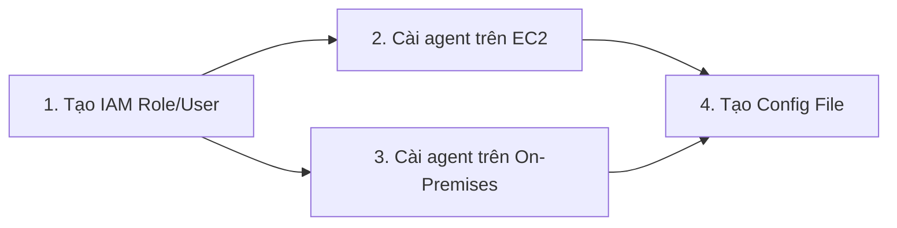

# Unified CloudWatch Agent: Cài Đặt Trên EC2 Và On-Premises
**Chủ đề (Topic):** Observability & Operations
**Domain liên quan:** SOA-C02 Domain 1 (Monitoring, Logging, and Remediation)
**Note liên quan:** `cloudwatch_getting_started.md` (Module 1-2), lab `d1-03` (agent + SSM Parameter Store)

---

## 0. Tóm Tắt Một Dòng
**Unified CloudWatch Agent** là một agent duy nhất thu cả **metrics hệ thống (in-guest: RAM, disk, swap, process)** và **logs**, chạy được trên **EC2 lẫn on-premises server** (Linux hoặc Windows Server), kể cả server không do AWS quản lý (hybrid).

---

## 1. Agent Này Giải Quyết Vấn Đề Gì?

Default metrics của EC2 (do hypervisor AWS sinh) chỉ thấy phần cứng ảo hóa: `CPUUtilization`, `NetworkIn/Out`, `DiskReadBytes`... AWS **không thấy bên trong OS**: RAM, dung lượng đĩa còn trống, process nào đang chạy. Lý do là ranh giới bảo mật của ảo hóa (hypervisor không đọc được bên trong guest OS).

Với server **on-premises** thì càng rõ: AWS không thấy gì cả vì máy không nằm trong hạ tầng AWS.

**Unified CloudWatch Agent** lấp cả hai khoảng trống đó: cài một phần mềm bên trong OS, đọc trực tiếp metric/log của máy rồi đẩy lên CloudWatch.

**Analogy:** agent như một nhân viên đo đạc bạn thuê đứng *bên trong* căn phòng. AWS từ ngoài chỉ nhìn được công tơ điện (CPU, network). Nhiệt độ, độ ẩm (RAM, disk) phải có người bên trong đo rồi gửi ra. *Chỗ analogy gãy:* agent còn gửi được cả log, không chỉ metric; và cùng một agent chạy được trên máy không thuộc AWS.

Agent làm được:
- Thu thêm **system-level metrics / in-guest metrics** từ EC2 (RAM, disk space, swap, procstat...).
- Thu **system-level metrics từ on-premises server** (kể cả hybrid, kể cả server không do AWS quản lý).
- Thu **logs** từ EC2 và on-premises, trên cả **Linux** và **Windows Server**.

---

## 2. Bốn Bước Setup Chính Thức

AWS chia quy trình thành 4 bước. Nắm đúng thứ tự và đúng "ai dùng cái gì" là qua được các câu hỏi thi dạng này.



### Bước 1: Tạo IAM Roles Và Users Cho Agent

Đây là bước **dễ sai nhất** và hay bị gài trong đề thi.

| Môi trường | Dùng danh tính gì | Vì sao |
| :--- | :--- | :--- |
| **Amazon EC2** | **IAM Role** gắn vào instance | Instance tự lấy credential tạm thời qua instance metadata, không cần lưu key trên máy. An toàn hơn. |
| **On-Premises Server** | **IAM User** (programmatic access, long-term access key) | Máy on-prem không chạy trong AWS nên không có instance role. Phải cấp access key cố định và lưu vào credentials file. |

> [!WARNING]
> AWS cảnh báo rõ: IAM user với **long-term credentials là rủi ro bảo mật**. Chỉ cấp đúng quyền tối thiểu (least privilege) và **xóa user khi không còn dùng**. Trong hybrid hiện đại, cách tốt hơn là cho on-prem server join **SSM** rồi dùng **temporary credentials** thay vì access key cố định (xem mục 5).

**Policy cốt lõi:** `CloudWatchAgentServerPolicy` — cho agent ghi metric/log lên CloudWatch, giao tiếp với EC2/SSM, và đọc config từ SSM Parameter Store **nếu tên parameter bắt đầu bằng `AmazonCloudWatch-`**.

**Tên role mẫu trong docs:** `CloudWatchAgentServerRole`.

Trường hợp đặc biệt:
- Nếu muốn agent **tự đặt retention policy** cho log group: thêm quyền `logs:PutRetentionPolicy`.
- Nếu muốn **lưu config vào Parameter Store** (để nhiều server dùng chung): cần một role/user thứ hai có quyền ghi Parameter Store. Quyền ghi này mạnh, chỉ gắn vào **một instance duy nhất** dùng để soạn config, không gắn đại trà.

### Bước 2: Cài Agent Trên EC2

- Gắn **IAM Role** (bước 1) vào instance.
- Tải và cài gói agent (agent **KHÔNG có sẵn**, phải tự cài — khác với SSM Agent thường cài sẵn trên AMI chính thức).
- Cài qua: Systems Manager Run Command / Distributor, hoặc tải gói `.deb`/`.rpm`/`.msi` cài thủ công.

### Bước 3: Cài Agent Trên On-Premises Server

- Tạo file credentials chứa access key của **IAM User** (bước 1), kèm chỉ định **Region** mục tiêu (on-prem không có Region mặc định như EC2).
- Tải gói agent phù hợp OS (Linux `.deb`/`.rpm`, Windows `.msi`) và cài.
- Có thể **tái dùng cùng một config file** đã tạo ở một máy cho nhiều on-prem server khác.

### Bước 4: Tạo CloudWatch Agent Configuration File

- File JSON định nghĩa thu gì (metrics, logs, procstat...), gồm 3 section chính: `agent`, `metrics`, `logs`.
- Cách tạo: chạy **wizard** `amazon-cloudwatch-agent-config-wizard`, hoặc viết tay.
- Lưu file: để tại chỗ trên máy, hoặc đẩy vào **SSM Parameter Store** để fleet dùng chung (tên nên bắt đầu `AmazonCloudWatch-`).
- Nạp config và start agent:

```bash
# Nạp config lần đầu và start agent (nguồn là Parameter Store)
amazon-cloudwatch-agent-ctl -a fetch-config -m ec2 -s -c ssm:AmazonCloudWatch-td-agent-config

# Trên on-premises đổi -m ec2 thành -m onPremise
amazon-cloudwatch-agent-ctl -a fetch-config -m onPremise -s -c file:/opt/aws/amazon-cloudwatch-agent/bin/config.json
```

> [!IMPORTANT]
> `append-config` nhận diện config theo **TÊN FILE**, không theo đường dẫn. Append một file trùng tên file đang dùng sẽ **GHI ĐÈ** chứ không nối thêm, kể cả khi hai file ở path khác nhau. Mọi config dùng chung trên một server phải khác tên file.

---

## 3. So Sánh EC2 vs On-Premises

| Tiêu chí | EC2 | On-Premises |
| :--- | :--- | :--- |
| Danh tính IAM | **Role** gắn instance | **User** + access key (hoặc SSM temp credentials) |
| Credential | Tạm thời, tự xoay vòng | Cố định (rủi ro) hoặc tạm thời nếu join SSM |
| Region | Lấy từ metadata instance | Phải khai báo trong credentials/config |
| Cài agent | Run Command / Distributor / thủ công | Thủ công hoặc qua SSM hybrid activation |
| Rủi ro bảo mật | Thấp | Cao hơn nếu dùng long-term key |

---

## 4. Metric Vào Namespace Nào, Thấy Ở Đâu?

- Metric do agent đẩy lên nằm trong namespace **`CWAgent`** (mặc định), **KHÔNG** phải `AWS/EC2`.
- Đây là **custom metric** → có thể tốn phí nếu nhiều, và dùng để tạo alarm như metric thường.
- Logs vào **CloudWatch Logs** theo log group/log stream bạn cấu hình.

---

## 5. Field Note: Hybrid Hiện Đại Nên Tránh Access Key Cố Định

Cách "IAM user + long-term access key" là cách kinh điển trong tài liệu và đề thi, nhưng trong thực tế production nên:
1. Cho on-prem server đăng ký vào Systems Manager bằng **hybrid activation** (cài SSM Agent).
2. Server dùng **temporary credentials** do SSM cấp, không cần lưu access key trên đĩa.

Đây là khuyến nghị bảo mật (least privilege, không secret tĩnh). *Đây là field note của mình, không phải nội dung bài học gốc — khi thi vẫn ưu tiên chọn theo mô tả chính thức trong đề.*

---

## 6. Điểm Thi Hay Gài (Exam Traps)

- "Muốn thấy **memory / disk space** của EC2" → cài **CloudWatch agent**, không có cách nào qua default metrics.
- "Thu metric từ **on-premises / hybrid / server không thuộc AWS**" → unified CloudWatch agent + **IAM user** (không phải role).
- EC2 = **role**, on-prem = **user**. Đảo ngược là bẫy.
- Agent **không cài sẵn**, phải tự cài (khác SSM Agent).
- Config lưu Parameter Store cho fleet 1 Region; fleet đa Region → **S3 + State Manager + Run Command** (xem note Parameter Store theo Region).

---

## 7. Câu Tự Kiểm Tra

Bạn cần thu metric RAM từ 10 EC2 instance ở Singapore và 5 server đặt tại datacenter công ty (không thuộc AWS), tất cả Linux. Hai nhóm máy này dùng **danh tính IAM** khác nhau như thế nào, và vì sao không thể dùng cùng một loại cho cả hai?

---

**Sources**
- [Create IAM roles and users for use with the CloudWatch agent](https://docs.aws.amazon.com/AmazonCloudWatch/latest/monitoring/create-iam-roles-for-cloudwatch-agent.html)
- [Prerequisites for the CloudWatch agent (Create IAM user for on-premises servers)](https://docs.aws.amazon.com/AmazonCloudWatch/latest/monitoring/prerequisites.html)
- [Install the CloudWatch agent on on-premises servers](https://docs.aws.amazon.com/AmazonCloudWatch/latest/monitoring/install-CloudWatch-Agent-on-premise.html)
- [Configure on-premises servers to use SSM Agent and the unified CloudWatch agent to use temporary credentials](https://aws.amazon.com/premiumsupport/knowledge-center/cloudwatch-on-premises-temp-credentials/)
