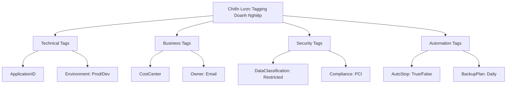

# Tối Ưu Hóa Quản Trị Đám Mây: Cân Bằng Bảo Mật và Chi Phí (Optimize Your Cloud Governance: Balance Security and Cost)
**Chủ đề (Topic):** Cost Governance  
**Khóa học (Course):** Optimize Your Cloud Governance: Balance Security and Cost  

---

## MODULE 1: Nền Tảng Của Cost-Aware Cloud Governance

### 1.1 Quản Trị Nhận Biết Chi Phí (Cost-Aware Governance)
Cloud Governance (Quản trị Đám mây) là khung quy tắc, thực tiễn và các cơ chế kiểm soát tự động (automated controls) nhằm liên kết các khoản đầu tư đám mây của tổ chức với mục tiêu kinh doanh, chính sách bảo mật (security policies) và giới hạn tài chính. Thông thường, cloud governance chỉ tập trung vào các ranh giới bảo mật và tuân thủ (security & compliance boundaries). Tuy nhiên, trong mô hình cloud-native hiện đại, **Cost-Aware Governance** kết hợp các chính sách bảo mật với tối ưu hóa tài chính, đảm bảo rằng mọi tài nguyên đám mây vừa an toàn vừa tối ưu chi phí.

Mục tiêu kép của Cost-Aware Governance bao gồm:
1. **Trách Nhiệm Tài Chính (FinOps)**: Chuyển dịch từ chi phí vốn cố định (CapEx) sang chi phí vận hành linh hoạt (OpEx), đòi hỏi khả năng hiển thị thời gian thực (real-time visibility) và trách nhiệm giải trình của doanh nghiệp đối với chi phí đám mây.
2. **Duy Trì Trạng Thái Bảo Mật (Security Posture Preservation)**: Đảm bảo các biện pháp tiết kiệm chi phí (như tắt bớt idle nodes hoặc giảm tần suất thu thập log) không tạo ra các lỗ hổng bảo mật, rủi ro mất dữ liệu, hoặc vi phạm tuân thủ (compliance).

---

### 1.2 AWS Well-Architected Framework cho Cost Governance
**Cost Optimization Pillar** (Trụ cột Tối ưu hóa Chi phí) của AWS Well-Architected Framework cung cấp các nguyên tắc thiết kế và thực tiễn tốt nhất để vận hành hệ thống đám mây nhằm mang lại giá trị kinh doanh tối đa với chi phí thấp nhất có thể.

#### 5 Nguyên Tắc Thiết Kế Cốt Lõi Cho Cost Optimization:
1. **Thực Hành Quản Lý Tài Chính Đám Mây (Practice Cloud Financial Management - CFM)**: Phân bổ tài nguyên chuyên trách, thành lập văn phòng FinOps (Cloud Business Office) và triển khai các công cụ tài chính để liên tục giám sát, quản lý chi tiêu.
2. **Áp Dụng Mô Hình Tiêu Dùng (Adopt a Consumption Model)**: Chỉ trả tiền cho tài nguyên tính toán thực tế tiêu thụ. Ngừng trả chi phí cho hạ tầng nhàn rỗi bằng cách tự động co giãn (autoscaling) theo nhu cầu thực tế của workload.
3. **Đo Lường Hiệu Quả Tổng Thể (Measure Overall Efficiency)**: Theo dõi chi phí vận hành đám mây dựa trên các chỉ số kinh doanh chính (ví dụ: chi phí cloud trên mỗi giao dịch của khách hàng). Điều này thiết lập một chỉ số ROI thực tế thay vì chỉ nhìn vào tổng chi tiêu thô.
4. **Ngừng Chi Tiền Cho Các Hoạt Động Khó Khăn Nhưng Không Tạo Ra Khác Biệt (Stop Spending Money on Undifferentiated Heavy Lifting)**: Hãy để AWS quản lý hạ tầng vật lý, máy chủ và các dịch vụ quản lý (managed services như RDS, DynamoDB, ECS) để đội ngũ kỹ sư tập trung phát triển mã nguồn ứng dụng độc quyền.
5. **Phân Tích Và Phân Bổ Chi Phí (Analyze and Attribute Expenditure)**: Xác định và phân loại quyền sở hữu tài nguyên thông qua hệ thống tagging chặt chẽ. Điều này tạo điều kiện thuận lợi cho việc chargeback (hoàn phí) hoặc showback (hiển thị chi phí) chính xác cho từng đơn vị kinh doanh (OUs).

#### Các Thực Tiễn Tốt Nhất (Best Practices) Quan Trọng:
* **COST01-BP05: Báo cáo và thông báo về tối ưu hóa chi phí (Report and notify on cost optimization)**: Thiết lập các dashboard báo cáo tự động và cảnh báo ngân sách (qua AWS Budgets và AWS Cost Anomaly Detection) để cảnh báo cho các bên liên quan khi chi tiêu vượt quá ngưỡng xác định.
* **COST03-BP05: Cấu hình các công cụ quản lý chi phí và hóa đơn (Configure billing and cost management tools)**: Sử dụng consolidated billing (thanh toán tổng hợp), phân bổ Savings Plans và Reserved Instances trên toàn bộ tài khoản, và tận dụng AWS Cost Explorer để phân tích xu hướng lịch sử dài hạn.

---

### 1.3 Hiểu Về Các Cost Governance Control
Quản trị đám mây dựa trên một kiến trúc phân tầng gồm các loại control được phân loại theo giai đoạn vòng đời và cơ chế vận hành của chúng:

| Loại Control | Cơ Chế Vận Hành | Ví Dụ Về Cost Governance | Ví Dụ Về Security Governance |
| :--- | :--- | :--- | :--- |
| **Preventive Controls** (Ngăn ngừa) | Chủ động ngăn chặn hành động không tuân thủ trước khi nó xảy ra. | Service Control Policy (SCP) giới hạn việc khởi tạo các instance type chi phí cao (ví dụ: các dòng `p4` hoặc `x1`). | IAM policy từ chối quyền thay đổi cấu hình Public Access Block của S3 bucket. |
| **Detective Controls** (Phát hiện) | Giám sát môi trường thực tế và gắn cờ vi phạm sau khi tài nguyên đã triển khai. | AWS Config rule kiểm tra các EBS volume không sử dụng (`volume-unused-check`) hoặc Elastic IP chưa liên kết (unassociated EIP). | AWS Security Hub phát hiện các port bảo mật mở công khai (ví dụ: port 22 mở cho `0.0.0.0/0`). |
| **Responsive Controls** (Phản hồi/Khắc phục) | Tự động thực thi mã lệnh hoặc quy trình công việc để khắc phục vi phạm được phát hiện. | AWS Systems Manager Automation document tự động stop một EC2 instance nếu CPU utilization <1% liên tục trong 14 ngày. | AWS Lambda function kích hoạt bởi EventBridge tự động xóa bỏ cấu hình public của một S3 bucket trái phép. |

---

## MODULE 2: AWS Organizations Và Multi-Account Governance

### 2.1 Chiến Lược Multi-Account Cho Cost Governance
Kiến trúc đám mây cấp doanh nghiệp phân tách các workload vào nhiều AWS account khác nhau và được quản lý tập trung thông qua **AWS Organizations**.

#### Lợi Ích Về Cost Governance Của Chiến Lược Multi-Account:
* **Phân Bổ Và Cô Lập Chi Phí Tuyệt Đối**: Một account đóng vai trò là một ranh giới tự nhiên. Chi phí phát sinh trong `Marketing-Prod-Account` được cô lập hoàn toàn với `Analytics-Dev-Account`, loại bỏ các phép toán phân bổ chi phí phức tạp và thiếu chính xác.
* **Thanh Toán Hợp Nhất (Consolidated Billing)**: Liên kết nhiều member account với một Management Account duy nhất.
  * *Volume Discounts (Chiết khấu theo sản lượng)*: AWS tổng hợp lượng tài nguyên sử dụng trên toàn bộ member account cho các dịch vụ như S3 và EC2, giúp tổ chức đạt được các mức giá theo bậc (tiered pricing) rẻ hơn.
  * * RI và Savings Plans Sharing*: Các cam kết mua RI hoặc Savings Plans thực hiện tại Management Account có thể tự động áp dụng để bao phủ các workload đang chạy phù hợp trong bất kỳ member account nào, tối đa hóa tỷ lệ bao phủ giảm giá (discount coverage).
* **Giảm Thiểu Vùng Ảnh Hưởng (Blast Radius)**: Các sự cố bảo mật hoặc vượt ngân sách (ví dụ: lỗi script lặp vô hạn tạo ra hàng loạt ECS task) chỉ bị giới hạn trong phạm vi một account Sandbox hoặc Dev, bảo vệ an toàn cho môi trường Production.

---

### 2.2 Service Control Policies (SCPs) Để Kiểm Soát Chi Phí (Cost Control)
Service Control Policies (SCPs) là các chính sách guardrail **lấy principal làm trung tâm (principal-centric)**, xác định giới hạn quyền hạn tối đa cho tất cả các IAM user và role trong các member account của tổ chức. SCPs không cấp quyền; chúng hoạt động như một bộ lọc, ngăn chặn các hành động cụ thể bất kể identity-based policy có cho phép hay không.

#### Các Use Case SCP Kiểm Soát Chi Phí Quan Trọng:
1. **Region Restriction (Giới hạn Vùng)**: Ngăn chặn khởi tạo tài nguyên tại các vùng địa lý đắt đỏ hoặc không được phép.
2. **Instance Size Constraints (Giới hạn Kích thước Instance)**: Giới hạn các nhà phát triển chỉ được sử dụng các instance family giá rẻ trong các OU Development và Test.
3. **Data Loss / Governance Protection**: Chặn các member account tắt hoặc xóa các hệ thống giám sát chi phí và bảo mật cốt lõi (như AWS Config hoặc CloudTrail).

#### Ví Dụ: Cost Governance SCP (JSON)
SCP sau đây chặn việc tạo các EC2 instance kích thước lớn đắt đỏ, bắt buộc chỉ tạo tài nguyên ở các Region được phê duyệt, và ngăn chặn hành vi can thiệp vào AWS Config recorder:

```json
{
  "Version": "2012-10-17",
  "Statement": [
    {
      "Sid": "DenyExpensiveEC2",
      "Effect": "Deny",
      "Action": [
        "ec2:RunInstances"
      ],
      "Resource": "arn:aws:ec2:*:*:instance/*",
      "Condition": {
        "StringNotLike": {
          "ec2:InstanceType": [
            "t2.*",
            "t3.*",
            "m5.large",
            "m5.xlarge",
            "c5.large",
            "c5.xlarge"
          ]
        }
      }
    },
    {
      "Sid": "RegionLockout",
      "Effect": "Deny",
      "Action": "*",
      "Resource": "*",
      "Condition": {
        "StringNotEquals": {
          "aws:RequestedRegion": [
            "us-east-1",
            "us-west-2",
            "eu-west-1"
          ]
        }
      }
    },
    {
      "Sid": "ProtectAWSConfigAndCloudTrail",
      "Effect": "Deny",
      "Action": [
        "config:DeleteConfigurationRecorder",
        "config:StopConfigurationRecorder",
        "cloudtrail:DeleteTrail",
        "cloudtrail:StopLogging"
      ],
      "Resource": "*"
    }
  ]
}
```

---

### 2.3 Resource Control Policies (RCPs)
Resource Control Policies (RCPs) là các chính sách **lấy tài nguyên làm trung tâm (resource-centric)** được quản lý tập trung trong AWS Organizations. Khác với SCPs (quản lý việc *ai* có thể hành động trong account), RCPs quản lý *cách thức* **tài nguyên nội bộ** của bạn được truy cập.

#### Thiết Lập Ranh Giới Dữ Liệu (Data Perimeter) Với RCPs:
* **Vấn Đề**: Một principal bị xâm nhập hoặc có hành vi gian lận trong AWS organization của bạn có thể truy cập hoặc sao chép dữ liệu nhạy cảm ra một S3 bucket bên ngoài thuộc sở hữu của kẻ tấn công, gây ra chi phí truyền tải dữ liệu (data exfiltration costs) khổng lồ và rủi ro rò rỉ dữ liệu.
* **Giải Pháp**: Một RCP đóng vai trò như một cơ chế kiểm soát ranh giới trên tài nguyên. Nó bắt buộc các tài nguyên của bạn (như S3 Buckets, KMS Keys, SQS Queues) **chỉ** được phép truy cập bởi các identity thuộc về chính AWS Organization của bạn.
* **Tác Động Chi Phí**: RCPs loại bỏ rủi ro các thực thể bên ngoài sử dụng trái phép tài nguyên dùng chung của bạn hoặc gọi liên tục vào các KMS key, SQS queue, hoặc S3 bucket của bạn. Vì các API request và data transfer được tính phí cho chủ sở hữu tài nguyên (resource owner), RCPs là một control tối quan trọng để ngăn chặn các đột biến hóa đơn ngoài ý muốn do traffic từ bên ngoài.

---

### 2.4 Tích Hợp AWS Control Tower
**AWS Control Tower** tự động hóa việc thiết lập một môi trường AWS multi-account an toàn, tuân thủ các thực tiễn tốt nhất (được gọi là landing zone).

#### Tích Hợp Cost-Governance Trong Control Tower:
* **Account Factory**: Đơn giản hóa việc provisioning (cấp phát) các member account chuẩn hóa, được cấu hình sẵn các IAM role, cấu trúc VPC, billing alarm (cảnh báo hóa đơn) và security control.
* **Automated Guardrails**: Tự động triển khai các SCPs đóng gói sẵn (preventive guardrails) và cấu hình các AWS Config rules (detective guardrails) trên toàn bộ các OU được quản lý.
* **Drift Detection (Phát hiện Lệch cấu hình)**: Cảnh báo cho quản trị viên nếu một tenant account thay đổi các thiết lập vi phạm chính sách tuân thủ hoặc giới hạn chi phí của tổ chức (ví dụ: tắt Config Recorder hoặc thay đổi tham số logging).

---

## MODULE 3: AWS Config Cho Cost Optimization Governance

### 3.1 Nguyên Lý Cơ Bản Của AWS Config Cho Tối Ưu Hóa Chi Phí Dựa Trên Cấu Hình
**AWS Config** liên tục giám sát, ghi lại và đánh giá các trạng thái cấu hình của tài nguyên AWS. Dịch vụ này duy trì một danh mục lịch sử đầy đủ của các Configuration Items (CIs), cho phép tổ chức theo dõi:
1. **Vòng Đời Tài Sản (Asset Lifecycles)**: Trực quan hóa chính xác thời điểm một tài nguyên được tạo, sửa đổi hoặc xóa bỏ.
2. **Quan Hệ Giữa Các Tài Nguyên (Relationships)**: Bản đồ hóa các kết nối (ví dụ: EBS volume nào đang được attach vào EC2 instance nào).
3. **Lệch Cấu Hình Tuân Thủ (Compliance Drift)**: Phát hiện ngay lập tức khi cấu hình tài nguyên bị lệch khỏi các mục tiêu chi phí hoặc bảo mật đã đặt ra.

Đối với tối ưu hóa chi phí, AWS Config hoạt động như một công cụ phát hiện (detective engine) tối ưu—tìm kiếm các tài sản bị bỏ quên (orphaned assets) đang âm thầm tích lũy chi phí hóa đơn lâu sau khi các workload liên quan của chúng đã bị xóa.

---

### 3.2 Conformance Pack Cho Cost Optimization
Một **Conformance Pack** là một tập hợp các AWS Config rules và remediation actions (hành động khắc phục) được đóng gói vào một template YAML duy nhất và triển khai trên toàn bộ AWS Organizations thông qua Management Account.

AWS cung cấp một conformance pack chuyên dụng có tên là **"Operational Best Practices for Cost Optimization"**. Gói này nhóm các AWS Config managed rules được thiết kế để phát hiện các tài nguyên nhàn rỗi (idle), sử dụng kém hiệu quả (underutilized), hoặc cấu hình sai.

#### Các Managed Rules Tối Ưu Chi Phí Quan Trọng:
* `volume-unused-check`: Đánh giá xem các EBS volume có ở trạng thái không gắn (unattached) với bất kỳ EC2 instance nào hay không. Các volume unattached này vẫn bị tính phí lưu trữ đầy đủ.
* `eip-attached`: Phát hiện các Elastic IP (EIP) đã được phân bổ cho account của bạn nhưng chưa được liên kết với một active running instance. AWS tính phí theo giờ đối với các unassociated EIPs để tránh lãng phí địa chỉ IP.
* `rds-instance-idle-check`: Xác định các RDS database instance không có bất kỳ active database connection nào trong một số ngày liên tiếp quy định.
* `ec2-instance-detailed-monitoring-enabled`: Bắt buộc bật detailed monitoring trên các EC2 instance để đảm bảo các dữ liệu metric có độ phân giải cao (tần suất 1 phút) sẵn sàng cung cấp cho các công cụ định cỡ như AWS Compute Optimizer.

#### Ví Dụ: Conformance Pack Template Snippet (YAML)
```yaml
AWSTemplateFormatVersion: '2010-09-09'
Description: AWS Config Conformance Pack for Cost Optimization Governance.
Resources:
  EBSVolumeUnusedCheck:
    Type: AWS::Config::ConfigRule
    Properties:
      ConfigRuleName: volume-unused-check
      Source:
        Owner: AWS
        SourceIdentifier: VOLUME_UNUSED_CHECK
  UnassociatedElasticIP:
    Type: AWS::Config::ConfigRule
    Properties:
      ConfigRuleName: eip-attached
      Source:
        Owner: AWS
        SourceIdentifier: EIP_ATTACHED
  RDSIdleCheck:
    Type: AWS::Config::ConfigRule
    Properties:
      ConfigRuleName: rds-instance-idle-check
      InputParameters:
        daysMinIdle: '14'
      Source:
        Owner: AWS
        SourceIdentifier: RDS_INSTANCE_IDLE_CHECK
```

---

### 3.3 Custom Config Rule Cho Cost Optimization
Khi các AWS Managed Rules có sẵn không đáp ứng đủ tính chi tiết của chính sách doanh nghiệp, bạn có thể thiết kế các **Custom Config Rules** thông qua hai mô hình:

1. **AWS Config Custom Policy Rules (Guard)**:
   * **Cơ Chế**: Viết bằng ngôn ngữ **CloudFormation Guard (CFN Guard)**—một ngôn ngữ khai báo chính sách dạng mã nguồn (declarative policy-as-code DSL).
   * **Lợi Ích**: Cực kỳ nhẹ, tốc độ thực thi nhanh, chạy serverless trực tiếp trong AWS Config. Không cần quản lý container thực thi riêng.
   * **Chế Độ Đánh Giá**: Hỗ trợ cả *Detective* (quét liên tục theo định kỳ) và *Proactive* (đánh giá tài nguyên trong pipeline IaC trước khi chúng thực sự được khởi tạo trên AWS).
2. **AWS Config Custom Lambda Rules**:
   * **Cơ Chế**: Kích hoạt một AWS Lambda function (viết bằng Python, Node.js, Go hoặc Java) chứa logic xử lý thủ tục phức tạp để đánh giá payload Configuration Item (CI) dưới dạng JSON.
   * **Use Case**: Cần thiết cho các đánh giá nâng cao yêu cầu truy vấn API bên ngoài, kiểm tra các hàng database đang hoạt động, hoặc so sánh chéo các dữ liệu billing.

#### Ví Dụ: Custom Guard Policy Rule Giới Hạn EC2 Instance Family (CFN Guard)
```guard
# Đảm bảo các EC2 instance chỉ sử dụng các dòng máy tối ưu chi phí
rule check_ec2_cost_family when resourceType == "AWS::EC2::Instance" {
    configuration.instanceType == /^t2\..*/ or
    configuration.instanceType == /^t3\..*/ or
    configuration.instanceType == /^m5\..*/
    <<
      "Violation: The EC2 Instance type does not belong to the cost-optimized t2, t3, or m5 families."
    >>
}
```

---

## MODULE 4: Cost Allocation và Tagging Governance

### 4.1 Nguyên Lý Cơ Bản Về Cost Allocation Tag
Tags là các cặp metadata key-value đơn giản được đính kèm trực tiếp vào các tài nguyên AWS. Trong quản trị chi phí, tags hoạt động như các dữ liệu đo lường chính kết nối việc tiêu dùng tài nguyên đám mây với cấu trúc kinh doanh của doanh nghiệp.

#### Cơ Chế Kích Hoạt Bắt Buộc (Crucial Activation):
* **Cạm Bẫy**: Việc chỉ gán tags cho tài nguyên (ví dụ: key `Project` value `Alpha`) trên console sẽ **không** hiển thị chúng trong các báo cáo billing hoặc dashboard phân tích chi phí.
* **Hành Động**: Để sử dụng tags cho việc theo dõi chi tiêu, chúng **bắt buộc** phải được đăng ký và **kích hoạt** thủ công trong **AWS Billing and Cost Management Console** dưới dạng **Cost Allocation Tags**.
* **AWS-Generated Cost Tags**: Được tự động điền bởi AWS (ví dụ: `aws:createdBy` theo dõi ai đã tạo tài nguyên). Cũng cần phải được kích hoạt để phân tích chi phí theo người tạo.
* **User-Defined Cost Tags**: Các tag do tổ chức tự định nghĩa và áp dụng (ví dụ: `CostCenter`, `ProjectID`, `BusinessUnit`).

---

### 4.2 Tag Policies Trong AWS Organizations
Để đảm bảo tính nhất quán của việc gắn thẻ trên một môi trường cloud doanh nghiệp quy mô lớn, bạn triển khai các **Tag Policies** tập trung thông qua AWS Organizations.

#### Các Tính Năng Của Tag Policies:
* **Chuẩn Hóa Case-Sensitivity**: Bắt buộc các key phải sử dụng viết hoa/thường chính xác (ví dụ: từ chối các tag ghi là `costcenter` hoặc `Costcenter` nếu tiêu chuẩn doanh nghiệp là `CostCenter`).
* **Giới Hạn Allowed Values**: Ràng buộc các value trong một danh sách được phê duyệt trước (ví dụ: quy định `Environment` chỉ có thể là `Prod`, `Stage`, hoặc `Dev`).
* **Báo Cáo Compliance**: Gắn cờ các tài nguyên không tuân thủ trên tất cả các member account mà không chặn trực tiếp các nhà phát triển, tạo điều kiện cho giai đoạn chuyển giao an toàn.
* **Tích Hợp Ngăn Chặn (via SCPs)**: Bằng cách kết hợp Tag Policies với một SCP có điều kiện như `aws:TagKeys`, bạn có thể chủ động chặn đứng việc tạo mới các tài nguyên thiếu các cost tags bắt buộc.

#### Ví Dụ: Tag Policy (JSON)
Tag Policy sau đây bắt buộc chuẩn hóa viết hoa/thường và giới hạn các value được phép cho thẻ `Environment` và `CostCenter`:

```json
{
  "tags": {
    "Environment": {
      "tag_key": {
        "@@assign": "Environment"
      },
      "tag_value": {
        "@@assign": [
          "Prod",
          "Stage",
          "Dev"
        ]
      },
      "enforced_for": {
        "@@assign": [
          "ec2:instance",
          "s3:bucket"
        ]
      }
    },
    "CostCenter": {
      "tag_key": {
        "@@assign": "CostCenter"
      },
      "tag_value": {
        "@@assign": [
          "CC-1001-Finance",
          "CC-2002-Engineering",
          "CC-3003-Marketing"
        ]
      }
    }
  }
}
```

---

### 4.3 Thiết Kế Chiến Lược Tagging (Tagging Strategy)
Một chiến lược tagging doanh nghiệp hiệu quả nên phân chia các tags thành 4 nhóm quản trị nền tảng:



1. **Technical Tags (Kỹ thuật)**: Xác định kiến trúc workload (`ApplicationID`, `Environment`, `ServiceComponent`).
2. **Business Tags (Kinh doanh)**: Xác định quyền sở hữu tài chính và vận hành (`CostCenter`, `Owner` [email], `BusinessUnit`).
3. **Security Tags (Bảo mật)**: Định hướng các cấp độ bảo vệ dữ liệu (`DataClassification` [Public/Restricted], `ComplianceRequirement` [PCI/HIPAA]).
4. **Automation Tags (Tự động hóa)**: Bật/tắt các tài nguyên tham gia vào các script tự động tắt hoặc quản lý vòng đời (`AutoStop` [True/False], `PatchGroup`, `BackupPlan`).

---

### 4.4 Báo Cáo Cost Allocation
Khi các Cost Allocation Tags được kích hoạt, đội ngũ tài chính có thể xây dựng các báo cáo phân bổ chi tiết bằng cách sử dụng các công cụ tiêu chuẩn của AWS:

* **AWS Cost Explorer**: Giao diện trực quan để phân tích chi phí lịch sử, dự báo chi tiêu tương lai và lọc biểu đồ theo các Cost Allocation Tags đang hoạt động.
* **AWS Cost and Usage Report (CUR)**: Nguồn dữ liệu gốc chi tiết nhất chứa thông tin chi tiết từng dòng (line-item) của mọi tài nguyên phát sinh chi phí, định dạng dưới dạng file CSV/Parquet khổng lồ xuất ra S3. Đội ngũ FinOps truy vấn CUR bằng **Amazon Athena** và trực quan hóa qua **Amazon QuickSight**.
* **Account Tags cho Cost Allocation**: Một tính năng nâng cao cho phép tổ chức gắn các thẻ metadata lên toàn bộ **AWS Accounts** trong AWS Organizations. Hệ thống billing sẽ đọc các account tags này để phân bổ chi phí cho các hạng mục dùng chung hoặc không thể gắn thẻ (ví dụ: phí AWS Support, chi phí baseline của Enterprise Agreement) về các OU tương ứng.

---

## MODULE 5: Tích hợp Security và Cost Governance

### 5.1 AWS Security Hub cho Quản trị Tập trung (Unified Governance)
**AWS Security Hub** là dịch vụ quản lý trạng thái bảo mật đám mây (Cloud Security Posture Management - CSPM) thực hiện các kiểm tra cấu hình tự động, liên tục trên toàn bộ môi trường AWS của bạn. Nó tổng hợp các phát hiện bảo mật (findings) từ nhiều dịch vụ AWS (GuardDuty, Inspector, Macie) và các công cụ bên thứ ba, ánh xạ mức độ tuân thủ theo các khung tiêu chuẩn ngành (ví dụ: CIS Foundations Benchmark, PCI-DSS, AWS Foundational Security Best Practices).

Mặc dù Security Hub là một công cụ bảo mật, đây cũng là một động cơ quản trị chi phí quan trọng. Các vi phạm bảo mật (như mở port SSH công khai hoặc để lộ root API access keys) hầu như luôn là nguyên nhân hàng đầu dẫn đến các khoản chi phí khổng lồ ngoài tầm kiểm soát.

---

### 5.2 Sự Cân Bằng Giữa Security Và Cost
Một thách thức lớn trong quản trị đám mây doanh nghiệp là quản lý sự đánh đổi giữa một môi trường siêu bảo mật (hyper-secure) và chi phí vận hành phát sinh để duy trì các hệ thống bảo mật đó.

```
       [SECURITY PROTOCOLS]                        [COST CONSTRAINTS]
+-----------------------------------+     +-----------------------------------+
| * Giám sát cấu hình liên tục      |     | * AWS Config tính phí trên mỗi CI |
| * Thu thập log mạng độ phân giải  | <=> | * VPC Flow Logs tính phí theo GB  |
| * Log kiểm toán chi tiết (Audit)  |     | * S3 Data Events có thể rất lớn   |
| * Chạy nhiều chuẩn tuân thủ       |     | * Security Hub tính phí theo check|
+-----------------------------------+     +-----------------------------------+
```

#### Chi Phí Của Bảo Mật (Cost of Security):
* **Logging Volume (Dung lượng Log)**:
  * *VPC Flow Logs*: Ghi lại mọi luồng packet trong một môi trường traffic cao vào S3 hoặc CloudWatch Logs sẽ tạo ra chi phí truyền tải và lưu trữ dữ liệu khổng lồ.
  * *CloudTrail Data Events*: Ghi nhật ký các hành động API read/write trên các active S3 bucket hoặc Lambda function tạo ra khối lượng log kiểm toán khổng lồ, làm tăng phí lưu trữ theo cấp số nhân.
* **Configuration Audits (Kiểm toán Cấu hình)**:
  * *AWS Config Recorder*: Được tính phí (billed) trên mỗi thay đổi cấu hình được ghi lại. Các workload thay đổi liên tục (như autoscaling, microservices) nếu ghi lại mọi thứ không chọn lọc sẽ tạo ra hóa đơn Config khổng lồ.
  * *Security Hub Checks*: Tính phí trên mỗi lượt kiểm tra tiêu chuẩn bảo mật được thực hiện trên mỗi account. Chạy nhiều framework trùng lặp sẽ tạo ra các lượt kiểm tra dư thừa, làm tăng chi phí.

#### Cơ Chế Bảo Vệ Tài Chính Của Bảo Mật:
Ngược lại, bảo mật chính là chốt chặn kiểm soát chi phí tối thượng. Một access key bị lộ có thể cho phép kẻ tấn công khởi chạy hàng trăm GPU EC2 instance để đào tiền ảo (crypto-mining), dẫn đến hóa đơn thảm họa chỉ trong vài giờ. Các preventive security controls trực tiếp bảo vệ doanh nghiệp khỏi các rủi ro tài chính này.

---

### 5.3 Các Security Control Nhận Biết Chi Phí (Cost-Aware Security Controls)
Để đạt được điểm cân bằng tối ưu giữa bảo mật và chi phí, các tổ chức triển khai các kiến trúc quản trị thông minh, có chọn lọc và tự động hóa:

#### 1. Chọn Lọc Network & Audit Logging:
* **VPC Logging Theo Trạng Thái**: Thay vì log toàn bộ packet, hãy cấu hình VPC Flow Logs chỉ log **REJECT** traffic, giúp nắm bắt các kết nối trái phép trong khi giảm dung lượng log ingest tới hơn 90%.
* **S3 Selective Data Logging**: Chỉ bật CloudTrail Data Events trên các bucket quan trọng, rủi ro cao (ví dụ: chứa dữ liệu tài chính thô), trong khi các bucket vận hành thông thường chỉ cần dựa trên Management Events cơ bản.

#### 2. Tối Ưu Hóa AWS Config Recording:
* Cấu hình AWS Config Recorder chỉ ghi lại **các resource type cụ thể** đại diện cho ranh giới bảo mật hoặc rủi ro chi phí lớn (như `IAM`, `EC2::Instance`, `S3::Bucket`, `VPC::SecurityGroup`), tránh ghi lại các tài nguyên có vòng đời ngắn (ephemeral).

#### 3. Chủ Động Phát Hiện Bất Thường Tài Chính:
* Triển khai **AWS Cost Anomaly Detection**. Công cụ dựa trên Machine Learning này giám sát các mô hình chi tiêu và cảnh báo cho quản trị viên trong vòng vài giờ khi phát hiện chi phí tăng đột biến bất thường, đóng vai trò là hệ thống cảnh báo sớm cho việc rò rỉ thông tin đăng nhập hoặc tài nguyên bị lạm dụng.

#### 4. Tự Động Hóa Ứng Phó Sự Cố (Remediation Architecture):
Tích hợp Security Hub và GuardDuty với các workflow tự động hóa để đạt được hiệu quả giảm thiểu chi phí và bảo mật tức thì:

```
[Phát hiện đe dọa: Đào tiền ảo]
              |
              v
       (AWS GuardDuty)
              |
              v (Kích hoạt EventBridge Rule)
      (Amazon EventBridge)
              |
              v (Gọi Target thực thi)
     (AWS Step Functions)
     +----------------------------------------+
     | 1. Cách ly EC2 Security Group          |
     | 2. Vô hiệu hóa IAM Credentials bị lộ   |
     | 3. Tắt ngay lập tức các Rogue Instance |
     +----------------------------------------+
              |
              v (Gửi thông báo)
     (Amazon SNS / Slack) --> Cảnh báo FinOps
```

1. **Phát Hiện Đe Dọa**: AWS GuardDuty xác định hành vi độc hại mức độ nghiêm trọng cao (ví dụ: một EC2 instance đang kết nối tới một pool đào Bitcoin).
2. **Kích Hoạt Event**: GuardDuty xuất một finding (phát hiện) tới **Amazon EventBridge**.
3. **Điều Phối Tự Động**: Một EventBridge rule kích hoạt một **AWS Step Functions** state machine.
4. **Thực Thi Khắc Phục**: Step Function gọi các Lambda function để:
   * Cách ly Security Group của EC2 instance bị nhiễm độc (chặn toàn bộ traffic ra/vào).
   * Tự động vô hiệu hóa (disable) các IAM access keys bị rò rỉ liên quan.
   * Tắt ngay lập tức instance đang chạy để chặn đứng chi phí compute đang phát sinh theo thời gian thực.
5. **Thông Báo**: Các đội ngũ FinOps và Security nhận được cảnh báo ngay lập tức qua Amazon SNS, bao gồm đầy đủ ngữ cảnh chi phí và các bước khắc phục đã thực hiện.
