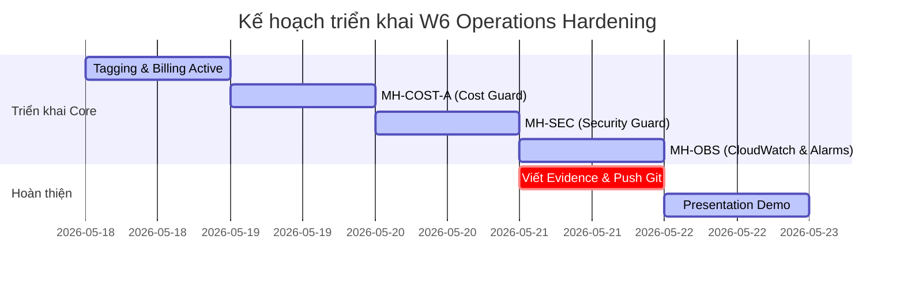

# Phân Tích & Hướng Dẫn Triển Khai Project Tuần 6
## Operations Hardening & Cost-Aware Cloud

Tài liệu này tổng hợp toàn bộ yêu cầu, các bước triển khai chi tiết, các lỗi thường gặp (pitfalls) và mẫu cấu trúc cho file minh chứng **`docs/W6_evidence.md`** của dự án Tuần 6.

---

## I. TỔNG QUAN & NGUYÊN TẮC CỐT LÕI (MỤC TIÊU SỐ 1)

### 1. Operations Hardening là gì?
Tuần này nhóm bạn **không xây dựng tính năng mới** cho ứng dụng. Thay vào đó, bạn sẽ lấy chính ứng dụng đã hoàn thiện từ W1-W5 để redeploy trên một AWS Account sạch và áp dụng lăng kính **Vận hành (Operations)** chuyên nghiệp:
* Hệ thống có tự phục hồi khi có sự cố không?
* Việc lưu trữ đã tối ưu hóa chi phí chưa?
* Bạn có thấy rõ từng đồng chi tiêu thuộc về dịch vụ/môi trường nào không?
* Các lỗ hổng bảo mật cấu hình sai có tự động được vá (Self-healing) mà không cần con người can thiệp không?

### 2. ⚠️ Trần Chi Phí Cứng $150 (Hard Cost Cap)
Tổng chi tiêu AWS Account của nhóm bạn cho W6 phải **$\le \$150$**. Nếu vượt quá $150$, **toàn bộ bài tập W6 của cả nhóm sẽ bị đánh giá THẤT BẠI (FAIL)** không có ngoại lệ.
* **Quy tắc vàng để giữ chi phí dưới $150$:**
  * Luôn sử dụng Single-AZ cho môi trường phát triển (Dev) - tránh Multi-AZ.
  * Chọn instance size nhỏ nhất có thể chạy được (ví dụ `t2.micro` hoặc `t3.micro`).
  * Ưu tiên các giải pháp Serverless khi có thể.
  * Thiết lập tắt các tài nguyên compute (EC2, RDS) vào ban đêm hoặc ngoài giờ làm việc.
  * **TUYỆT ĐỐI KHÔNG** bật các dịch vụ siêu đắt đỏ: *Bedrock Provisioned Throughput*, *OpenSearch Multi-Node*, *EKS*.

---

## II. CHI TIẾT 4 CORE MUST-HAVES (BẮT BUỘC)

### 1. MH-COST-V — Cost Visibility & Attribution (Hiển thị & Phân bổ chi phí)
* **Mục tiêu:** Nhận biết chi tiết từng đồng chi tiêu thuộc về dịch vụ nào, do ai sở hữu và thuộc ứng dụng nào.
* **Các thành phần bắt buộc:**
  * **Component 1 - Tagging Discipline:** Gắn tag nhất quán trên mọi tài nguyên tính phí được redeploy (EC2, RDS, Lambda, S3, EFS, API Gateway...). Tối thiểu gồm 4 tags:
    * `Owner`: Email của người chịu trách nhiệm chính (viết hoa nhất quán, không dùng lẫn `owner` và `Owner`).
    * `Environment`: `dev` (viết thường nhất quán, không trộn lẫn `Dev` và `dev` vì Cost Explorer phân biệt chữ hoa thường).
    * `CostCenter`: Mã nhóm của bạn (ví dụ `G7`).
    * `Application`: Tên ứng dụng của bạn (ví dụ `HealthBot`).
  * **Component 2 - Activate Cost Allocation Tags (BẮT BUỘC):** Vào AWS Billing Console $\rightarrow$ **Cost allocation tags** $\rightarrow$ tìm key `Owner` và `Application` của bạn $\rightarrow$ Click **Activate**. Nếu bỏ qua bước này, tags sẽ không xuất hiện làm filter dimension trong Cost Explorer.
  * **Component 3 - Thiết lập ít nhất 1 công cụ giám sát chi phí:**
    * *Cost Explorer:* Thiết lập filter theo tag của nhóm để quan sát xu hướng chi tiêu.
    * *AWS Budgets:* Tạo cảnh báo ngân sách chủ động (phải cấu hình trước Thứ Sáu).
    * *Cost Anomaly Detection:* Sử dụng ML để phát hiện chi tiêu tăng vọt bất thường.
  * **Component 4 - Baseline cost breakdown:** Sau khi redeploy ít nhất 24 giờ, chụp ảnh biểu đồ chi phí theo Tag trong Cost Explorer. Viết 1 đoạn văn (1 paragraph) phân tích **Top 3 cost drivers** và chỉ ra điểm nào bất ngờ hoặc cao hơn dự kiến.
  * **Tagging Strategy Document:** Viết một tài liệu dài 1 trang mô tả quy chuẩn gắn thẻ, các giá trị hợp lệ, và cách kiểm soát tuân thủ trong môi trường thực tế.

---

### 2. MH-COST-A — Cost Control & Action (Kiểm soát & Tự động hành động)
* **Mục tiêu:** Xây dựng cơ chế tự động hoá thực sự tác động lên tài nguyên để tiết kiệm chi phí, không chỉ dừng ở mức gửi email thông báo suông (Cost Theater).
* **Các thành phần bắt buộc:**
  * **Component (a) - Stop Lambda:** Viết một Lambda function bằng Python (boto3) thực hiện quét toàn bộ EC2/RDS. Nếu instance **không có tag `keep=true`** (hoặc thuộc `Environment=dev`), tiến hành Stop (hoặc Terminate) chúng.
    * *Quyền hạn tối thiểu (IAM Least-Privilege):* Chỉ cấp các quyền `ec2:StopInstances`, `ec2:DescribeInstances`, `rds:StopDBInstance`, `rds:DescribeDBInstances`. Tuyệt đối không dùng wildcard `*`.
  * **Component (b) - Daily Scheduled Trigger:** Cấu hình **EventBridge Scheduler** (hoặc cron rule) định kỳ chạy Lambda này mỗi ngày (ví dụ: tắt toàn bộ compute lúc 20:00 tối).
  * **Component (c) - Demonstrated Action:** Chứng minh một instance thật chuyển từ `running` $\rightarrow$ `stopped` thành công bởi Lambda. Chụp ảnh trạng thái **Before/After** kèm log CloudTrail của event dừng tài nguyên (`StopInstances` hoặc `StopDBInstance`).
  * **Component (d) - Cost-Driven Path & Latency ADR:**
    * Cấu hình AWS Daily Budget ở $150 \rightarrow$ gửi thông báo tới một **SNS Topic** $\rightarrow$ SNS trigger chính Lambda Stop phía trên.
    * **Latency ADR:** Do dữ liệu chi phí AWS thực tế bị trễ từ 8–24h, cơ chế kích hoạt dựa trên cost thật này sẽ không kịp tự nổ trong môi trường workshop 48h. Bạn cần viết ADR giải thích độ trễ này và cách hệ thống vận hành thực tế ở production, đồng thời demo chuỗi hành động này bằng cách **publish test message thủ công vào SNS topic** để xem Lambda tắt instance thành công.

---

### 3. MH-OBS — Monitoring: Know Before the User Does (Khả năng giám sát)
* **Mục tiêu:** Đảm bảo khả năng quan sát sâu sắc để giải quyết sự cố trước khi người dùng phát hiện ra.
* **Các thành phần bắt buộc (Cả 3 thành phần, không phải chọn 1 trong 3):**
  * **Component A - CloudWatch Dashboard với Custom Metric:**
    * Tạo một CloudWatch Dashboard.
    * Dashboard phải hiển thị **ít nhất 1 Custom Metric** do chính code ứng dụng gửi lên qua API `PutMetricData` (ví dụ: độ trễ gọi Bedrock `InferenceLatencyMs`, số lượng tokens, số lỗi đăng nhập thất bại...).
    * Đặt widget chứa Custom Metric này bên cạnh **ít nhất 2 standard infrastructure metrics** (ví dụ: EC2 CPU, RDS DatabaseConnections, Lambda Error Rate).
  * **Component B - CloudWatch Alarm ở trạng thái OK hoặc ALARM:**
    * Alarm tuyệt đối không được ở trạng thái `INSUFFICIENT_DATA` vào Thứ Sáu (nghĩa là alarm chưa từng nhận được dữ liệu nào để đánh giá).
    * Bạn phải chạy ứng dụng vào chiều Thứ Năm để sinh dữ liệu. 
    * Khuyên dùng: Tạo alarm giám sát lỗi Lambda (ví dụ >5 errors trong 5 phút). Thực hiện gọi Lambda lỗi 6 lần liên tiếp để ép Alarm chuyển sang trạng thái `ALARM`, chụp ảnh quá trình chuyển đổi trạng thái (state transition).
  * **Component C - Saved Log Insights Query:**
    * Viết và lưu một câu query trong CloudWatch Logs Insights nhắm vào một Log Group thực tế (Lambda logs, API Gateway logs, VPC Flow Logs...).
    * Query phải nâng cao (chứa các câu lệnh như `stats`, `sort`, `parse`, hoặc regex) để trích xuất thông tin hữu ích (ví dụ: Top 10 IP bị reject nhiều nhất trong VPC Flow Logs, hoặc Thống kê lỗi Lambda theo block 5 phút).
    * Lưu câu query này lại trong console (**Saved Queries**).

---

### 4. MH-SEC — Self-Healing Security Guard (Hạ tầng tự chữa lành bảo mật)
* **Mục tiêu:** Xây dựng vòng lặp tự động sửa lỗi cấu hình sai bảo mật gần như thời gian thực mà không cần con người can thiệp.
* **Các thành phần bắt buộc:**
  * **Lambda Auto-Fix (Code tự vá lỗi):** Viết Lambda function tự động sửa lỗi cấu hình sai bảo mật. Chọn 1 trong 2 kịch bản khuyên dùng:
    * *Kịch bản 1:* Nếu phát hiện Security Group có rule ingress mở port 22 hoặc 3389 ra toàn bộ internet (`0.0.0.0/0`) $\rightarrow$ Lambda gọi API `RevokeSecurityGroupIngress` để xóa rule đó đi ngay lập tức.
    * *Kịch bản 2:* Nếu phát hiện một S3 bucket của ứng dụng bị chuyển sang trạng thái Public $\rightarrow$ Lambda gọi API `PutPublicAccessBlock` để bật lại Block Public Access ở mức bucket.
    * *IAM Least-Privilege:* Cấp quyền tối thiểu cho Lambda (ví dụ chỉ được revoke ingress rule hoặc put public access block, cấm wildcard `*`).
  * **Trigger:** EventBridge rule bắt CloudTrail event (ví dụ: `AuthorizeSecurityGroupIngress` hoặc `PutBucketPolicy` / `PutBucketAcl`) để tự vá lỗi gần như thời gian thực (near real-time), HOẶC cấu hình chạy định kỳ qua EventBridge Scheduler hàng ngày làm fallback.
  * **Demo Loop (Vòng lặp tự lành):** Cố ý tạo ra vi phạm (mở port 22 cho `0.0.0.0/0` hoặc mở public S3 bucket) $\rightarrow$ Lambda tự động phát hiện và vá lại $\rightarrow$ Cung cấp ảnh chụp trạng thái **Before (Insecure)**, **After (Remediated)** và event CloudTrail ghi nhận API vá lỗi thành công.
  * **Supporting Preventive Control (Chọn 1 trong 3):**
    * *Option A:* Tạo một **KMS Customer Managed Key (CMK)**, bật tính năng tự động xoay vòng key (Automatic key rotation) và áp key này để mã hóa một database store (RDS, S3, EBS...). Xác nhận qua CloudTrail log có event `kms:GenerateDataKey` hoặc `kms:Decrypt` từ dịch vụ đó.
    * *Option B:* Bật **S3 Block Public Access ở cấp độ Account** + Áp dụng Bucket Policy từ chối (Deny) các upload không mã hóa hoặc upload non-TLS (`aws:SecureTransport=false`) + Chụp minh chứng một lệnh upload thử bị từ chối.
    * *Option C:* Bật **IAM Access Analyzer** và thực hiện phân tích/xử lý (triage) ít nhất 1 phát hiện (finding) truy cập từ bên ngoài.
  * **Security-Cost Trade-off (Bắt buộc):** Viết 1-2 câu giải thích chi phí của giải pháp bảo mật bạn chọn và tại sao chi phí đó là hợp lý (ví dụ: KMS CMK tốn $1/tháng nhưng được chấp nhận vì giúp audit cụ thể được IAM principal nào đã decrypt dữ liệu nhạy cảm).

---

## III. CÁC STRETCH GOALS / BONUS (TỐI ĐA +0.5 ĐIỂM, +0.25 MỖI MỤC)

Để lấy điểm cộng và làm phong phú thêm câu chuyện vận hành cho vòng thuyết trình:
1. **Migration gp2 $\rightarrow$ gp3 EBS (+0.25):** Migrate EBS volume từ gp2 sang gp3 không cần downtime. Ghi nhận thông số IOPS/throughput, volume ID, và so sánh chi phí tiết kiệm được.
2. **Trusted Advisor Remediations (+0.25):** Xử lý triệt để **ít nhất 2 findings dạng config-based** (ví dụ: unattached EBS volume, unassociated Elastic IP, missing S3 lifecycle rules...) kèm minh chứng Before/After rõ ràng.
3. **RI / Savings Plans Break-even Analysis (+0.25):** Phân tích tài chính chi tiết nếu mua Savings Plans cho hệ thống so với dùng On-Demand hiện tại cho workshop hoặc dự án thực tế.
4. **"Wasteful $\rightarrow$ Changed" Reflection (+0.25):** Viết một đoạn văn 100-150 từ đánh giá những tài nguyên lãng phí nhóm đã tìm thấy trong stack cũ, nhóm đã thay đổi thế nào và hiệu quả tiết kiệm chi phí/hiệu năng thực tế là bao nhiêu (sử dụng số liệu thật).
5. **Cost Anomaly Automation (+0.25):** Cấu hình Cost Anomaly Detection theo tag dự án $\rightarrow$ EventBridge $\rightarrow$ SNS $\rightarrow$ Gửi email cảnh báo và demo giả lập.
6. **Double Security Auto-Fix (+0.25):** Thiết lập Lambda tự vá lỗi bảo mật xử lý thành công **đồng thời cả 2 lỗi** cấu hình sai bảo mật (Security Group mở & S3 bucket public) kèm minh chứng đầy đủ.

---

## IV. CẤU TRÚC CHUẨN FILE TÀI LIỆU MINH CHỨNG `docs/W6_evidence.md`

Nhóm của bạn nên tạo file **`docs/W6_evidence.md`** trực tiếp trong thư mục repository và áp dụng mẫu (template) chuẩn dưới đây để điền thông tin trong quá trình thực hành:

```markdown
# W6 Evidence Pack: Operations Hardening & Cost-Aware Cloud

## Section 1: Cover & Team Information
* **Group ID:** [Ví dụ: Group 7]
* **Tên các thành viên:** [Danh sách thành viên]
* **Link Git Repository:** [Link repo của nhóm]
* **Link W5 Evidence Pack:** [Chèn link W5 Evidence làm tham chiếu]
* **Phản hồi từ W5:** [Ngắn gọn cách nhóm đã giải quyết feedback của W5 (nếu có)]

---

## Section 2: MH-COST-V — Cost Visibility & Attribution
### 1. Tagging Strategy Document
[Trình bày tài liệu quy định gắn thẻ dài 1 trang: Các key bắt buộc, giá trị hợp lệ cho từng môi trường, quy chuẩn chữ hoa chữ thường, và cách kiểm tra compliance].

### 2. Gắn thẻ tài nguyên thực tế
* *Mô tả:* Minh chứng đã gắn đầy đủ 4 key (`Owner`, `Environment`, `CostCenter`, `Application`) trên ít nhất 3 loại tài nguyên khác nhau.
* 
* 
* 

### 3. Kích hoạt Cost Allocation Tags
* *Mô tả:* Xác nhận đã activate hai key `Owner` và `Application` trong AWS Billing Console.
* 

### 4. Thiết lập công cụ giám sát chi phí (Cost Explorer / Budgets)
* 

### 5. Baseline Cost Breakdown & Phân tích
* 
* **Nhận xét (1 Paragraph):** [Phân tích Top 3 dịch vụ tiêu tốn nhiều chi phí nhất và những phát hiện bất ngờ nếu có].

---

## Section 3: MH-COST-A — Cost Control & Action (Automated Cost Guard)
### 1. Code Lambda & Cấu hình IAM Role (Least-Privilege)
* *Mô tả:* Code Lambda quét và tắt tài nguyên dev/không có tag `keep=true`.
* [Chèn Code block Python tại đây]
*  *(Phải thấy rõ quyền cụ thể, không được dùng "*")*

### 2. EventBridge Scheduler (Daily Cron Trigger)
* 

### 3. Minh chứng Tự động dừng tài nguyên (Stop Action Proof)
*  *(Trạng thái: Running)*
*  *(Trạng thái: Stopped)*
*  *(Event: StopInstances hoặc StopDBInstance)*

### 4. Kết nối Budget -> SNS -> Lambda & Latency ADR
* 
* 
* **Latency ADR (Bản ghi quyết định kiến trúc về độ trễ):** [Giải thích lý do tại sao dữ liệu chi phí bị trễ 8-24h và cách nhóm thiết lập bypass bằng Test SNS để xác thực tự động hóa].

---

## Section 4: MH-OBS — CloudWatch Observability
### 1. CloudWatch Dashboard
* 
* *Mô tả:* Phải thấy rõ widget của **Custom Metric** bên cạnh 2 standard metrics.

### 2. Code Snippet `PutMetricData` trong ứng dụng
```python
# Ví dụ đoạn code python publish Custom Metric lên CloudWatch
```

### 3. Cấu hình CloudWatch Alarm (OK / ALARM State)
* 
* *Mô tả:* Trạng thái Alarm đang là OK hoặc ALARM (không được là INSUFFICIENT_DATA).

### 4. Saved Log Insights Query
* **Query Text:**
  ```sql
  fields @timestamp, @message | filter @message like /ERROR/ | stats count(*) as error_count by bin(5m)
  ```
*  *(Show rõ danh sách Saved Queries và kết quả ít nhất 5 dòng).*

---

## Section 5: MH-SEC — Self-Healing Security Guard
### 1. Code Lambda & IAM Execution Role
* [Chèn Code block Python của Security Lambda]
*  *(Quyền tối thiểu: RevokeSecurityGroupIngress hoặc PutPublicAccessBlock).*

### 2. EventBridge Trigger (CloudTrail Event / Scheduler Rule)
* 

### 3. Vòng lặp Tự vá lỗi thực tế (Demo Loop Proof)
*  *(Ví dụ: Port 22 mở 0.0.0.0/0 hoặc Bucket public)*
*  *(Rule bị revoke hoặc BPA bật lại)*
*  *(Event: RevokeSecurityGroupIngress hoặc PutPublicAccessBlock)*

### 4. Supporting Preventive Control (KMS CMK / S3 Account BPA / Access Analyzer)
* [Trình bày minh chứng cụ thể cho Option mà nhóm chọn. Ví dụ: KMS CMK rotation đang bật kèm CloudTrail log sử dụng key].
* 
* 

### 5. Threat Context & Security-Cost Trade-off Statement
* **Threat Context:** [Mô tả ngắn gọn về loại cấu hình sai được bảo vệ và hậu quả/blast radius nếu nó bị khai thác].
* **Security-Cost Statement:** [Giải thích bài toán chi phí/lợi ích của control đã áp dụng đối với giới hạn ngân sách $150].

---

## Section 6: Project Recap (W1 - W5)
[Viết một đoạn văn ngắn tóm tắt: Tên ứng dụng, mô hình kinh doanh (business domain), và các quyết định kiến trúc/thiết kế chính từ tuần 1 đến tuần 5 để trainer nắm được bối cảnh ứng dụng].

---

## Section 7: Bonus / Stretch Goals (Tùy chọn)
[Cung cấp đầy đủ bằng chứng, so sánh số liệu trước/sau cho bất kỳ mục bonus nào nhóm đã hoàn thành].
```

---

## V. KẾ HOẠCH HÀNH ĐỘNG TUẦN & TỪNG NGÀY KHUYÊN DÙNG

Để kịp tiến độ nộp bài trước 17:00 chiều Thứ Năm:



* **Thứ Hai:** Thống nhất Tagging strategy, redeploy hạ tầng và **bật ngay Cost Allocation Tags** trong Billing console để kích hoạt bộ lọc.
* **Thứ Ba:** Hoàn thành **Automated Cost Guard (MH-COST-A)**. Cần đảm bảo scheduler chạy thử ít nhất 1 lần để có log CloudTrail `StopInstances` thật. Cài đặt CloudWatch Agent lên EC2.
* **Thứ Tư:** Hoàn thành **Self-Healing Security Guard (MH-SEC)** và triển khai giải pháp mã hoá KMS hoặc BPA cho S3.
* **Thứ Năm:** Xây dựng Dashboard CloudWatch, kích hoạt ứng dụng để chuyển trạng thái CloudWatch Alarm từ `INSUFFICIENT_DATA` sang `OK/ALARM`. Viết Logs Insights Query. Hoàn thiện toàn bộ file `docs/W6_evidence.md` và gửi commit link cho trainer trước 17:00 chiều.
* **Thứ Sáu:** Thuyết trình nhóm (10-12 phút):
  * **Part 1 (~1.5 phút):** Recap dự án cũ bằng lời/slide (không cần demo app).
  * **Part 2 (~3 phút):** Đi qua Diagram kiến trúc chứa 4 lớp vận hành của W6.
  * **Part 3 (~3 phút):** Q&A cá nhân với trainer (mọi thành viên đều có thể bị gọi hỏi về code Lambda, IAM role, cơ chế KMS, và độ trễ chi phí).
  * **Part 4 (~3–4 phút):** Live demo các vòng lặp tự chữa lành bảo mật và tắt tài nguyên không tag trực tiếp.
